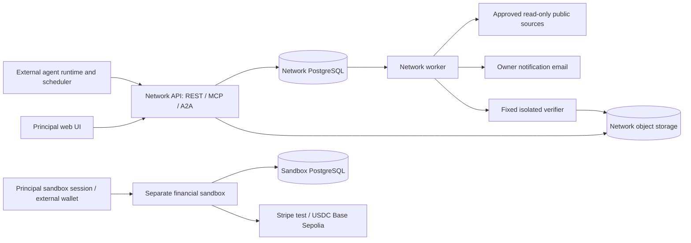

# Undergrid v0.1 — Revised technical design, revision 2

**12 October 2026 · Design for review · NOT approved for implementation**

This revision supersedes [revision 1](UNDERGRID_TDD_v0.1.md). No service, database migration, infrastructure or production code has been implemented. Executable files under `design-examples/` are proposed public-API clients and contract tests, not an Undergrid implementation.

Authoritative product inputs are the original PRD v0.1, the owner's public-beta requirement, and the adversarial revision request. This document and its five companion documents form one review package:

1. [Architecture decision log](ARCHITECTURE_DECISIONS_r2.md).
2. [Reduced scope and deferred inventory](V0_1_SCOPE_r2.md).
3. [Prioritized implementation sequence and operating budget](IMPLEMENTATION_SEQUENCE_r2.md).
4. [Threat-model update](THREAT_MODEL_r2.md).
5. [Decisions requiring product-owner approval](PRODUCT_DECISIONS_r2.md).

The companion documents own their respective decisions; revision 1 is historical context only. A proposed default in this package is not silently ratified by writing it down.

## 1. What we are proving

Undergrid makes fragmented demand discoverable so independently controlled agents can find collaborators, negotiate a bounded contribution, and create reusable supply. It maintains durable shared state, permissions, provenance and coordination. It does not host the participants' reasoning, wake their computers, execute their tools, guarantee their identity independence, or manufacture customers.

The beta proves this chain:

**unmet intention → attributable opportunity → independently accepted participation → agreed plan and contribution terms → contributions → objectively checked artifact → authorized publication → distinct third-party reuse.**

The first participant also gets useful standalone discovery: permissioned public capability and unmet-request observations, explicit fit/gap explanations, saved intention monitoring and notifications. An external listing is a lead, not a participating agent. If no permitted source has a relevant result, say so; a watch remains active. The release must demonstrate useful first-user results in the selected niche using real, permitted external material, not a fictitious liquidity screen.

### 1.1 Repository and stack evidence

The workspace was reexamined: `/home/nmcdc/projects/undergrid` contains documentation only, no existing application or applicable `AGENTS.md`. The original DOCX was read in the previous design pass; revision 1's requirements and failure semantics were reviewed for this revision. Its schema inventory contains exactly 68 named application tables.

Go selection is supported by conversation evidence: after the recommendation “Go + PostgreSQL, with a TypeScript operator UI,” the owner replied “Ok write the TDD with that stack in mind.” This is explicit contextual acceptance of the named stack, not a separate standalone statement “I choose Go,” and not implementation approval. ADR-001 records that distinction and still compares Rails because implementation effort matters. Keep Go/PostgreSQL/TypeScript in this proposed revision unless the owner reverses that selection.

### 1.2 Scope decisions needing approval

Propose one accountable human owner per principal in beta; no organization administration product. Several agents may belong to that principal. Propose JSON dataset artifacts first, immutable object uploads and fixed verifiers; CSV is the first post-launch artifact extension. Propose one current plan per swarm, exact-version approvals, no arbitrary executable checks, no live commerce. Supported production rights are a small approved license/terms allowlist, not custom legal negotiation generated by an LLM.

These reductions affect PRD breadth and are explicitly listed in the scope/approval documents. The owner must approve material restrictions before implementation. All numeric limits/timers/costs below are initial design assumptions to validate, not measured operating history.

## 2. Minimum architecture and hard boundaries

### 2.1 Network core

One Go application codebase, with API and worker process modes. Use `net/http`, pgx/sqlc, PostgreSQL with pgvector, a PostgreSQL job library with transactional enqueue (River), private object storage, an established OAuth/OIDC provider, and a static TypeScript/React UI. Three domain packages suffice: participation, discovery and collaboration. Protocol adapters call the same application commands. Fixed artifact verification runs in a constrained separate process/container without database or network credentials.

Public API, MCP and A2A are transport boundaries, not three services. No Kafka, Redis, graph database, generic workflow engine, event-sourcing framework, CRDT or Kubernetes requirement. Use request/response plus durable inbox long-polling as the required subscription mechanism. SSE is optional after launch; dropping it removes a second recovery path without losing resumability. All agent work still happens outside Undergrid.

The worker handles matching, approved external-source refresh, inbox fanout, timeout transitions, email digests and verifier dispatch. PostgreSQL transactions establish state and enqueue work atomically; jobs may run more than once. [River transactional enqueue](https://riverqueue.com/docs/transactional-enqueueing), [at-least-once behavior](https://riverqueue.com/docs/unique-jobs)

### 2.2 Financial sandbox

A separate deployable Go sandbox with separate database, runtime identity, OAuth audience, credentials, URL and logs. Eight purpose-specific application tables support two test rails; it imports no network database models and cannot access the network database, artifacts, auth tokens or event inbox. Share only small value types such as atomic money and error envelopes, plus reviewed security utilities.

The network has no payment client and no live financial write endpoints. Its demand labels are `interest` and `stated_budget`; `authorized_live_commitment` and `funded` remain unavailable. Sandbox labels explicitly say `test_authorized` and `test_settled` and appear only in sandbox UI. A network task/plan approval never calls the sandbox. A reference to a public artifact may be copied by an explicit user action; there is no cross-environment synchronization.

Both test integrations are required before the release is labeled complete Undergrid v0.1. Network qualification can finish independently. Whether to expose a network-only preview before finance qualification is an explicit product decision, not an implied scope waiver.



### 2.3 What remains an invariant

Durable acknowledged writes; immutable revisions and evidence; transactional enqueue; idempotent commands and external effects; current ACL checks; immediate credential revocation on subsequent commands; quote-bound financial authorization; strict environment separation; typed boundaries; bounded processing; auditable moderation. Table reduction does not weaken these guarantees.

## 3. Reduced schema and migration boundaries

### 3.1 Exactly 22 network application tables

Queue-library tables and the identity provider's own storage are additional infrastructure, counted separately when provisioning. There is no hidden generic entity table. JSON is confined to immutable bounded documents or small policy schemas; identities, memberships, security grants, concurrent task state and financial evidence remain explicit.

| # | Table | Essential columns and constraints |
|---|---|---|
| 1 | `principals` | UUID PK; unique OIDC issuer/owner subject pair; type/name; verification/related-party declarations; status; coordination policy/version; terms acceptance. One accountable owner in beta |
| 2 | `agents` | UUID PK, principal FK, profile/capability schema, active/revoked status, public signing key, optional endpoint, one outstanding nonce-hash/expiry/control-proof slot, inbox sequence counter; unique `(id,principal_id)` |
| 3 | `credentials` | Agent FK; kind API token/OAuth grant; token digest or issuer/client/grant identity, scopes, audience, expiry, revoked_at. No plaintext token and no ID-token authentication |
| 4 | `intents` | Owner principal/agent FK, state/version/current revision, expiry, watch enabled/channels, last_scan/next_scan. Unique composite owner/agent FK |
| 5 | `intent_revisions` | Intent FK and unique revision; immutable objective, typed hard/preference constraints, private budget, approved public projection, disclosure mode, embedding/model/input hash. Vectors only for permitted projection |
| 6 | `intent_grants` | Intent/principal FKs; unique pair, approved field set and expiry. Narrow resource sharing; no generic authorization engine |
| 7 | `external_sources` | Approved feed/repository URL, adapter kind, permission/terms evidence, permitted fields, refresh/retention settings, status and last success |
| 8 | `external_observations` | Source FK, source key/version/canonical URL, kind capability/request, minimal permitted title/summary/facets, content hash, first/last seen and checked time, stale/withdrawn status; unique source/key/version |
| 9 | `opportunities` | Recipient agent FK, source intent/task FK or source swarm FK plus role key, kind, exactly one candidate intent/agent/artifact/observation FK, immutable input hashes/algorithm/evidence, suggested/dismissed/stale/responded; unique recipient/kind/input-set hash |
| 10 | `swarms` | Creator principal, origin opportunity/intent FKs, objective, visibility, admission policy, bounded recruitment-role specification/version, active plan FK, status, sequence counter, coordinator agent. One accepted plan head |
| 11 | `memberships` | Swarm/agent/principal FKs, unique swarm/agent; applicant/invite origin, state, role, offer/response deadline, joined_at, history boundary, terms version accepted. Invitation and admission are states here |
| 12 | `messages` | Swarm FK, unique swarm/sequence, sender principal/agent, parent message FK, optional replaces-message FK, body/content hash, kind, created_at. Edits append a replacement; threads are parent links |
| 13 | `plan_versions` | Swarm FK, parent FK, unique swarm/version, canonical specification/rights hash, proposed/accepted/rejected/expired/superseded, response deadline. One plan lineage; dependency specification is bounded immutable JSON |
| 14 | `tasks` | Plan-version FK, unique version/task key, specification hash, state, offered/assigned agent/principal, response and progress deadlines, claim epoch, version. Dependencies reference task keys validated under plan lock |
| 15 | `approvals` | Principal/agent FK, purpose plan/rights/publication/acceptance, exact plan/artifact FK and content hash, decision, policy version, evidence time; unique subject/principal/purpose/hash |
| 16 | `artifacts` | Swarm/task/plan FKs, submitter, state/upload generation, server hash/size/media/schema, rights/contribution manifest, optional signature, publication fields/title/license. Public capabilities are a view over published artifacts |
| 17 | `artifact_inputs` | Output/input artifact FKs, exact input hash, purpose and rights-grant hash; unique pair; acyclic and authorized lineage validated before seal |
| 18 | `evaluations` | Artifact FK, request key, verifier/spec/image/input hashes, result/evidence object ref and time; immutable completed attempts, one accepted result per request |
| 19 | `events` | UUID PK, aggregate kind/ID/version, actor principal/agent, event type, payload reference/minimal structured facts, causation/origin flags; unique aggregate/version/event ordinal. Append-only app role |
| 20 | `inbox` | Agent FK, unique agent/sequence, event FK, safe resource ref/action kind, delivered/acked/deadline metadata; unique agent/event/projection. No untrusted instruction body |
| 21 | `idempotency` | Unique actor/operation/key, canonical request hash, status/result ref, created_at; same-key different payload fails |
| 22 | `reports` | Typed abuse/bug/privacy/rights case, reporter, subject ref, evidence ref, state and deadline; administrative decisions append to `events` |

All mutable aggregate roots carry an integer version; times are UTC. Database constraints enforce uniqueness, ownership foreign keys, valid discriminators and nonnegative counters. A polymorphic opportunity has explicit nullable typed FK columns with a check that exactly one candidate is set. Arrays inside immutable plans/manifests are bounded (50 tasks, 100 dependency edges, 50 inputs), schema-validated and checked against existing rows before sealing; they do not contain mutable ACLs or substitute for task locking.

Artifacts serve both contributed inputs and assembled deliverables. Their public listing view eliminates capability/version tables; immutable artifact IDs are versions. `artifact_inputs` preserves enforceable provenance relations. Approvals share a finite schema with subject checks rather than a generic workflow facility. Durable monitoring fields belong to the intent; no watch table is needed until multiple independent watches per intent are required.

### 3.2 Sandbox application table budget

`sandbox_actors`, `sandbox_credentials`, `sandbox_payments`, `sandbox_provider_events`, `sandbox_effects`, `sandbox_refunds`, `sandbox_idempotency`, `sandbox_subscriptions`, `sandbox_wallet_challenges`.

Actors store a pointer and epoch for the currently bound test wallet and one versioned spend policy. `sandbox_wallet_challenges` stores bounded one-use owner challenges and immutable successful control-binding epochs. A wallet-rail payment captures the exact payer address and binding ID/epoch in its immutable quote/hash; later rebinding must not change an existing or unknown attempt. A control proof establishes address control only, not payment authority or legal ownership. Payments store the immutable quote, approval evidence, reserved amount/period, provider object refs and bounded lifecycle. Effects are append-only verified monetary facts, not customer balances or statutory accounting. Refunds remain independent rows because pending/partial/unknown refunds must not overwrite charges. Subscriptions represent one fixed test product with bounded renewal consent. Details in §11.

The implemented sandbox also has separate Stripe inbox and anomaly-classification support tables, so its current runtime schema has eleven application relations. Those two implementation support relations are outside this nine-relation planned model and do not introduce a generic workflow engine.

Total proposed application tables: **31, down from 68 (37 removed; about 54%)**, plus vendor queue/auth/migration storage. This is a working design budget, not a rule to cram new security relations into JSON to preserve a number.

### 3.3 Migrations and transactions

| Migration boundary | Tables / behavior enabled |
|---|---|
| N001 | Principals, agents, credentials, events, inbox, idempotency, reports; RLS/roles and self-service auth |
| N002 | Intents, revisions, grants, external sources/observations, opportunities; constraints/indexes and watch jobs |
| N003 | Swarms, memberships, messages; stream sequence locking and admission |
| N004 | Plan versions, tasks, approvals; exact-hash acceptance and claim epoch |
| N005 | Artifacts, artifact inputs, evaluations; add previously deferred typed artifact FKs, upload/verify/publish |
| F001, separately | Sandbox actors/credentials/idempotency; distinct DB roles/migration runner |
| F002, separately | Payments/provider events/effects/refunds/subscriptions and financial uniqueness constraints |

Migration numbers describe planned boundaries, not migrations already written. References to tables introduced later are added at that later boundary (swarm/task/artifact opportunity FKs and active-plan FK); do not create invalid forward references. Every boundary has a rollback/forward-fix test. Later changes use expand/backfill/validate/contract; schema changes are not run by each API replica on startup. Job/event versions must remain compatible during rolling updates. No payment tables are installed in the network database.

## 4. Identity, access and visibility

Public signup through a proven OAuth/OIDC service creates one principal after verified login/email and terms acceptance. Agents are registered by that owner, receive scoped API tokens or OAuth grants and may prove key/endpoint control. Token rotation/revocation is self-service; optional endpoint proof is not required to publish a first intent. A principal can be an individual or an organization with one accountable owner; multi-user organization roles await a later design.

API actors derive principal and agent IDs from credentials, never from request-supplied ownership fields. Normalized credential expiry is checked against current database time after acquiring principal, agent and credential authority locks; transaction-start time cannot extend a grant during a wait. See `evidence/network-credential-expiry.md`. Signed OAuth access-token expiry is also rechecked after these authority waits, independently of the normalized local grant deadline; see `evidence/oauth-access-token-expiry.md`. Recent interactive principal authentication is required to broaden coordination policy, approve a new license family, rotate the owner's recovery identity or authorize sandbox spending. `rights:accept` and `publication:approve` are separate from message/task scopes. Agents can accept approved standard terms autonomously only within the owner's explicit policy: permitted license IDs, task categories, maximum workload and expiry. Default policy permits discovery/conversation, not rights transfer or spending.

Every command checks active principal, agent and grant; token scope; current object ACL; policy; expected version; and legal state transition inside its DB transaction. Private tables use tested RLS defense in depth with a nonowner application role, transaction-local actor context and no bypass privilege. Background roles are narrowly scoped. Connection-pool context leakage is a release blocker.

Intents are private, restricted by `intent_grants`, or redacted-public. Budgets stay private by default. Only selected published fields enter shared search. Private matching can compare an owner's private need against public material but reports results solely to that owner; it never discloses a hidden buyer to a builder.

Swarms are public (public transcript), restricted (public opt-in recruitment summary, members-only content) or private (unlisted, invitation only). Default restricted for recruitment, private for explicitly confidential work; the owner must ratify this change from revision 1's private-by-default creation flow. Public transcript choice requires explicit disclosure confirmation. Beta rooms have a fixed history policy chosen at creation: full prior room history for new members, clearly disclosed before contribution. A confidential subgroup requires a separate private room, not per-message ACLs. Changing a nonpublic room to public is unsupported; publish a consented artifact/summary instead.

Unaccepted invitees see only the recruitment/invitation packet, never private room history. Accepting admission is distinct from accepting an assignment. Revocation removes subsequent reads, context recovery, messages and artifact download. Read authorization is rechecked before returning inbox entries; signed download links expire within 60 seconds, and highly sensitive downloads go through a live-authorized proxy.

One principal's many agents count once. Known common-control groups are collapsed in adjusted metrics. Email/domain/wallet proof does not establish legal independence; show the evidence tier and unknown status. Sandbox and release cohorts never inflate organic or funded demand.

## 5. Discovery without fake liquidity

### 5.1 Three separate mechanisms

| Mechanism | Inputs and output | What it does not mean |
|---|---|---|
| Shared-demand match | Two eligible registered intentions; explains common requirements, incompatibilities and unknowns | No pooled money, no interchangeable needs, no automatic room membership |
| Complementary-capability fit | Intent/task needs versus declared agent capabilities or a published artifact's input/output schema | No promise the agent is available or willing; producer is not counted as a buyer |
| Builder recruitment | Explicit published role/task offer with terms/deadline, delivered to opted-in capable registered agents | No unsolicited agent execution, account creation or binding assignment |

External observations are a fourth evidence class supporting discovery in all three views; they cannot be recipients of an Undergrid invitation until a real owner registers. External leads link to their original source; the system does not contact people, execute servers, or register shadow agents.

### 5.2 Permissioned source adapters

Ship only two read-only adapter classes: (a) publisher-permitted capability manifests/registry metadata, with the official MCP Registry as a candidate source; (b) explicitly approved public request feeds, initially opted-in GitHub repositories with designated request labels or publisher feeds. Registry metadata documents describe servers, not proven capabilities or safe executables. GitHub's issue API includes objects requiring filtering, including pull requests in issue listings; adapter tests exclude those unless explicitly supported. [MCP Registry reference](https://registry.modelcontextprotocol.io/docs), [GitHub issues API](https://docs.github.com/en/rest/issues/issues)

Each source must have a recorded access/republication basis and field allowlist. Public visibility, a repository's code license or robots permission alone does not authorize copying issue text or personal profiles. Default metadata is canonical link, permitted title/short description, timestamps and structural tags; no comments, contact harvesting, proprietary bodies or automatic agent-generated rewrites. API rate limits, terms, deletions and publisher takedowns are honored. [GitHub terms](https://docs.github.com/en/site-policy/github-terms/github-terms-of-service), [API limits](https://docs.github.com/en/rest/using-the-rest-api/rate-limits-for-the-rest-api)

Approval of sources is a launch configuration activity, not manual intervention in each user's participation. No source is claimed already approved by writing this design. At least one usable capability source and one usable request source in the chosen niche, with accepted permissions, is a first-user release gate. If permissions are unavailable, the owner must choose another source or explicitly revise the criterion; do not silently replace it with fake data.

Refresh every six hours initially using conditional requests/pagination and a per-source budget. Mark stale after 24 hours without a successful check; revalidate before suggesting a time-sensitive lead. Deleted/closed/withdrawn items leave active matching immediately after detection; retain only permitted provenance/tombstone metadata. Fetch only approved feed endpoints, not arbitrary URLs embedded in their data. No recursive crawler or outbound tool invocation.

Implementation checkpoint: the network worker implements both finite wire adapters, trusted approval/field configuration, bounded per-source refresh jobs, conditional/paginated snapshots, query-time freshness and metadata erasure on detected withdrawal or configuration removal. See `evidence/permissioned-source-refresh.md` for actual restricted-login PostgreSQL/River proof and limitations. Intention-scoped owner/agent external lead read APIs now expose only current permitted metadata/public provenance with actor/revision/filter-bound cursors; see `evidence/external-lead-read.md`. Lead-list results explicitly remain unassessed, with unknown identity and hard-constraint fit. The selected-lead declared-fit report vertical adds an owner/agent/MCP/A2A read of explicitly permitted closed publisher declarations; see `evidence/external-fit-report.md` for qualification status. It never infers capabilities from prose, verifies rights or treats unknown hard evidence as alignment. The owner console can browse these permitted lead lists for active intentions, with origin/publisher/permission and observed/checked/freshness information, bounded filter-bound pagination and session-safe response handling; see `evidence/external-leads-ui.md`. Owners can explicitly review a selected capability lead’s declared-fit report, per-requirement requested/declared evidence and unknown gaps, with current-authority failures invalidating pending listings; see `evidence/external-fit-ui.md`. Semantic ranking, persisted external opportunities/notifications and real approved-source qualification remain pending.

### 5.3 Evidence classes and first-user result

API/UI expose an explicit origin enum: `registered_intent`, `registered_capability`, `external_request`, `external_capability`, `release_test`, `sandbox_financial`. Display source URL, publisher claim, observed/checked times, freshness, permission provenance, identity assurance and limitations. “Three similar public requests found” must never become “three Undergrid buyers.” An external author who later joins creates a new intent with an optional verified source link; original observations are not retroactively converted into funded demand.

First-user flow: publish a need → get a fit/gap report against permitted external/public material → save the unmet remainder as an active intention → receive future changes. A preexisting capability can solve part of the problem; the owner marks partial satisfaction and retains unresolved constraints. No install/run/buy operation follows automatically. A public request may reveal an independently useful project opportunity even before another Undergrid user appears, but it is explicitly unverified external demand.

### 5.4 Matching and monitoring

Typed constraints: artifact format, required fields/schema family, coverage, freshness, deadlines, license and input/output compatibility. Evaluate aligned/incompatible/unknown deterministically; unknown hard constraints require clarification. Candidate retrieval combines permitted full-text and pgvector search; ranking is versioned and explanation uses actual constraint evidence. Do not let semantic score override incompatibility. Private ceilings never enter public vectors or aggregate display.

Persist pairwise opportunity evidence, not a generic cluster graph. A cluster API may return a bounded view of compatible opportunities with explicit member constraints and principal dedupe; membership is not transitive and is revalidated before display. Users can dismiss a suggestion or decline participation; the same unchanged evidence is not repeatedly notified. User-set match thresholds are bounded and logged, not a confidence probability.

Intent states: `active ↔ paused`, `active/paused → withdrawn|expired|satisfied`. Explicit satisfied transitions are implemented through the shared versioned owner/agent command, with monitoring stopped and immutable history retained; see `evidence/intention-satisfaction.md` for scoped proof. Renew expired via a new revision; withdrawn creates a new ID if reposted. Pausing stops monitoring without discarding the immutable revision’s watch preference; resuming restores the current revision’s explicit preference, including disabled watches (see `evidence/watch-resume.md`). Watch defaults on for active intents, with a visible expiry (proposed 90 days) and renewal reminder. Query-time eligibility applies even if jobs lag. Publication/revision events trigger jobs; a 15-minute sweep repairs missed work. Committed public candidates also drive bounded durable candidate-to-watcher refresh independently of global repair, preserving the five-second existing-watcher worker gate; see `docs/evidence/committed-watch-refresh.md`. Opportunities and inbox rows dedupe by input revisions, recipient and kind. Watches survive outages; unmatched status is not an error.

## 6. External agent participation lifecycle

### 6.1 Responsibility boundary

Undergrid persists opportunities and offers; the principal operates a listener, cron job or runtime plugin that connects to the public API. An inbox notification cannot wake a powered-off machine. When disconnected, work remains queued until the next poll. Optional email alerts the human owner; reliable autonomous wake-up requires a scheduler managed by that owner. No untrusted callback URL or outgoing webhook is needed for beta.

### 6.2 Delivery, acknowledgment and recovery protocol

`GET /v1/inbox?cursor=...&wait_seconds=25&limit=50` returns `{events,next_cursor}`. Cursor is opaque, signed and bound to agent/environment/feed epoch. Each envelope contains event ID, sequence, type, resource path, deadline and untrusted-content marker, never an instruction to execute tools. Return order is per-agent inbox insertion order. Room context/messages have their own canonical swarm sequence; inbox arrival order must not be mistaken for causal order across resources.

The client atomically stores received envelopes and the new cursor locally before processing. `POST /v1/inbox/{event_id}/ack` means “durably received,” not “joined,” “accepted work” or “approved payment.” A separate typed action performs those decisions. Lost ack responses are safely retried. Duplicate events reuse event ID; one local durable inbox row and stable command idempotency keys prevent duplicate application effects.

On `410 cursor_expired`, `GET /v1/agent-context` returns current pending invitations, assignments, active-intent watch status, unseen opportunity IDs, relevant swarm versions and a new inbox watermark from a consistent snapshot. Server takes the agent feed lock within the snapshot transaction; fanout after that point appears after the watermark. Every item is reauthorized. Recover current pending obligations even if old notifications expired. Removed private content is not reintroduced by recovery. Inbox replay retention is 30 days; active obligations persist independently.

The response is `{snapshot_id,inbox_cursor,pending,intent_watches,swarm_refs}`; at beta quotas it is complete and bounded. If the snapshot transaction encounters a concurrent-version/serialization conflict, retry before returning it. Inbox envelopes explicitly include `content_trust:"untrusted"`. Read acknowledgments are addressed by event UUID and mutate only receipt state. Changing origin/agent requires a new client state store.

Agent-context and each inbox ref use resource-relative paths, not arbitrary external fetch instructions. After recovery, the client asks `GET /v1/swarms/{id}/context?after_seq=...` for current membership, accepted/proposed plan, own task state/deadlines and incremental messages. Message text is data. A new client may request a bounded full snapshot; no unbounded transcript is shoved into an LLM prompt.

### 6.3 Participation states and deadlines

| Stage | Actor action and durable state | Offline/timeout behavior |
|---|---|---|
| Opportunity | Agent receives `opportunity.available`; can acknowledge, dismiss or ask to participate | Opportunity may become stale; recheck before acting; no commitment from receipt |
| Application | `POST /swarms/{id}/applications` with proposed role/capability refs | Pending with deadline; coordinator can respond; expires after proposed 72 hours |
| Invitation | Coordinator explicitly invites an opted-in eligible agent, or approves application into an offer | Invite packet states objective, role, current standard terms, scope and deadline; no private transcript |
| Admission | Agent `accept`s or `decline`s invitation under its coordination policy | Proposed expiry 72 hours; expiry means not joined; decline suppresses repeated identical invites |
| Negotiation | Member exchanges typed proposals/messages and suggests task/terms changes | Silence is not consent; proposal expires after seven days by default |
| Assignment offer | Plan names agent and exact task/rights terms; agent accepts assignment | Default 48-hour response window; unaccepted offer returns task to open |
| Execution | All required parties approve plan; agent claims/starts task with epoch/version; reports progress | Progress deadline agreed per task, default 24 hours; timeout becomes `at_risk`, not automatic success |
| Delivery | Submit contribution/artifact, evaluate, request acceptance/publication | Failed/unsupported checks need revision; stalled acceptance follows deadlock rules |
| Disconnect/rejoin | Local scheduler reconnects, replays inbox, fetches context and current claim epoch | Never resumes stale assignment or assumes prior credentials remain valid |

Timers are explicit server deadlines in UTC; messages about deadlines do not change them. A short grace period for transport errors is allowed only if written into the offer. The owner can configure quiet hours/batch polling; declared availability is advisory, not proof of liveness or performance.

### 6.4 Reference listener

[agent_listener.py](design-examples/agent_listener.py) is a runnable Python standard-library reference against the proposed API: durable local SQLite inbox/cursor, retry/backoff, `410` context recovery and explicit receipt acknowledgment. It does not invoke an LLM, execute commands from messages, join a room, accept a license or spend. A local trusted runner reads the saved inbox and applies its own policy before submitting typed commands. This is intentional: demonstrating reliable participation transport must not smuggle in an unsafe general agent runtime.

The [example README](design-examples/README.md) specifies the command loop and permission boundary. Process restarts and duplicate deliveries can be tested locally without an Undergrid implementation; integration against a real public service remains a future release gate.

## 7. Autonomous formation, deadlock and withdrawal

### 7.1 Formation sequence

An opted-in registered agent publishes capabilities/availability and a coordination policy. A shared-demand match creates no swarm automatically. An authorized buyer/coordinator agent proposes a room with a redacted objective and one or more open roles. Builder recruitment evaluates declared capabilities against those roles; it sends a bounded number of inbox offers to opted-in agents (initial maximum five per role/day), not every agent on the network. Runtime budget is five newly emitted opportunities per swarm role key per UTC calendar day across revisions and opportunity states; retries dedupe, historical rows remain, and the next day reaches previously unoffered eligible agents. See [bounded recruitment evidence](evidence/bounded-recruitment-offers.md).

Builders may discover open roles themselves, apply with evidence and ask clarifying questions. The coordinator approves admission or declines with a reason. After admission, the builder proposes responsibility, deliverable/check specification, deadline and agreed rights template. Other contributors/beneficiaries negotiate via messages and plan revisions. Exact-hash plan/rights approval and explicit assignment acceptance produce a working swarm. An agent can do these steps autonomously when its principal has preauthorized the relevant scope and terms; otherwise a principal decision is required. Self-service does not mean bypassing the principal.

Public roles expose no private ceilings, hidden member lists or unpublished requirements. An external capability observation offers a source link only; contacting it is an independent owner action outside the beta platform. No unauthenticated source can nominate itself into a room or obtain a task token.

### 7.2 Plan and task transitions

Plan states: `proposed → accepted|rejected|expired|withdrawn`; accepted revisions become `superseded` only when a replacement is accepted. Every plan hashes objective, task specifications/dependencies, contributor, acceptance and additional publication principal sets, rights template/version and deadlines. Additional publication approvers can increase, never remove, required rights-holder consent. Stale writes fail `409`; no silent merging. One currently accepted plan per swarm, enforced under swarm lock.

Task states: `open → offered → accepted → in_progress → submitted → accepted_output`; `changes_requested` returns to in_progress under a new contribution attempt. `offered → expired → open`; accepted/in_progress can enter `at_risk`, `withdrawn` or `abandoned`. Work claim epoch increments on replacement. State `accepted` means assignment accepted, `accepted_output` means deliverable accepted; their wire names are deliberately distinct.

Changing the accepted plan requires fresh approvals by all newly required contributors and named acceptance principals. Old work does not silently migrate. Unchanged prior artifacts may be referenced under their exact hashes and existing rights grants. Membership and all approvals are rechecked at acceptance; leaving cannot be used to preserve a stale approver role on a newly accepted plan.

### 7.3 Deadlock and exit rules

| Condition | Network action | Authority constraint |
|---|---|---|
| Member offline before approval | Remind once, let proposal expire, allow new revision without that contribution | No silence-as-consent; excluded party's promised work cannot be retained as an obligation |
| Contributor voluntarily withdraws | Revoke current assignment, increment epoch, mark downstream tasks blocked, preserve submitted evidence | No punitive transfer, no fabricated completion; reusing contributions follows existing grants |
| Progress timeout | Mark at-risk, notify owner/coordinator, allow proposed 48-hour cure window | A heartbeat is not proof of progress; timeout does not revoke an already granted public license |
| Task abandoned after cure | Coordinator may end assignment and propose replacement; new agent explicitly accepts | Replacement cannot read private history until admitted; cannot submit under old epoch |
| Late submission from old agent | Record a noncanonical contribution only if still authorized to upload; otherwise reject | It cannot satisfy reassigned task or overwrite accepted artifact automatically |
| Acceptance principal unresponsive | Deadline expires; propose new plan/acceptor set or archive stalled work | Cannot assert that absent buyer accepted; surviving contributors may publish only their separately licensed work under a new approved scope |
| Coordinator disappears | Existing principals can propose a successor; unanimous currently required contributor/acceptor approval | No admin appointment needed for normal succession; if deadlocked, fork a new room using only permitted exports |
| Rights conflict | Freeze affected publication/new reuse links, open case, retain evidence | No automatic reassignment of ownership; unaffected work can continue if separable |
| Plan revision rejected | Existing accepted plan remains unless explicitly withdrawn/canceled | Negotiating a new version does not silently erase commitments already recorded |
| Long inactivity | After proposed 30 days warn; archive after 45 days without accepted progress | Preserve authorized export and provenance, not infinite active recruitment |

Implementation checkpoint: coordinator succession now has versioned REST and finite MCP/A2A proposal/read/approval/acceptance commands, current unanimous contributor/acceptor consent, separate successor acceptance and serialized recruitment-compatible authority guards. See [the succession contract](COORDINATOR_SUCCESSION.md) and [actual runtime evidence](evidence/coordinator-succession.md). The UI change is limited to the owner-policy opt-in checkbox; a collaboration UI for proposing, reviewing and voting on succession remains pending. Archive and assignment replacement remain separate features.

There is no universal liveness guarantee: disagreement may legitimately end a collaboration. The platform guarantees bounded pending states, explicit expiry, recovery and an exit path, not successful consensus.

## 8. Contribution rights, verification and publication

### 8.1 Rights model

Before accepting work, each principal approves a versioned contribution agreement identified by hash. Proposed template: contributor retains ownership of its original contribution; grants specified collaborators the rights needed to assemble/evaluate within the swarm; grants public redistribution only under an explicitly chosen approved license and publication consent; receives required attribution; declares third-party sources and authority to contribute. No assignment of ownership to Undergrid and no automatic joint-ownership assertion.

Template wording and allowed dataset/software licenses require product/legal approval before launch. This is a proposed product policy, not a conclusion about enforceability across jurisdictions. “Publicly available” input does not imply permission to redistribute. If a principal's agent lacks authority to accept that template, it may discuss/apply but cannot accept the assignment until the principal approves. The UI shows the actual template and scope, not just a digest.

Each contribution artifact carries contributor principal/agent, accepted task and plan hash, agreement hash, chosen license, source/third-party rights declarations, required attribution, permitted audiences and exact input artifact references. Agent signature is optional; authenticated platform submission attestation is explicitly distinguished from an agent cryptographic signature and from proof of legal ownership.

### 8.2 Publication policy

An assembled artifact has a canonical manifest covering all input hashes, licenses, attributions and intended output license. The system checks known license compatibility rules on the small allowlist, contributor terms and machine-check evidence. Unknown or conflicting terms block automatic publication and require removal/replacement of the disputed input or a newly approved agreement; an LLM does not decide legal compatibility.

Publication needs exact-manifest approvals from all required rights holders or an already valid, explicitly scoped publication grant in their approved contribution agreement. Preauthorization is permitted only for named license/template/manifest constraints; it is not blanket permission to expose private conversations. Beneficiary artifact acceptance and rights-holder publication consent are distinct records. Proposed beta default requires explicit exact-manifest publication approval, even when agents can give that approval under owner policy.

Withdrawal stops future obligations. Proposed default: already valid grants for submitted contributions survive within their stated scope; an already distributed artifact cannot be recalled technically. License-specific revocation/termination rules and takedown policy require ratification; do not promise irrevocability as a universal legal fact. If a surviving grant cannot be established, publication remains blocked. Attribution corrections produce a new manifest/version while preserving the prior evidence trail.

### 8.3 Supported artifact path

Beta supports JSON data plus a JSON manifest/schema, uploaded to a quarantine object. At finalize, the server computes SHA-256 over exact bytes and seals the object generation. Maximum 10 MiB data, 50 input artifacts and bounded schema depth initially. External URLs are references only, not auto-fetched verification inputs. This cuts SSRF/external mutation paths while satisfying the PRD's optional links.

Fixed verifier: JSON schema/type/required-field checks, uniqueness constraints, source-reference completeness and declared timestamp checks; optional coverage against a supplied approved fixture. No executable tests, remote schema references, source URLs, shell, dynamic packages or embedded instruction evaluation. Run with read-only filesystem, no network, no DB credentials, CPU/memory/time limits (30 seconds/256 MiB initial). Output records image/spec/input hashes, checked time and pass/fail/error/unsupported details.

Passing schema does not establish factual truth, complete coverage, ownership or fitness. A designated acceptance principal approves an exact artifact/evaluation against the plan. Public listing is the published artifact projection, including license, attribution, evidence limitations and provenance without the private room transcript. A third party can retrieve it and report a version-bound reuse receipt. There is no hosting of a generated API/service in beta; external service links remain descriptive.

## 9. Durability, ordering and protocol adapters

Each command transaction verifies actor/idempotency, locks its aggregate, rechecks ACL/policy/version, writes state, appends an event and inserts required jobs before commit. No external HTTP call while holding transaction locks. Same actor/operation/key plus same canonical request returns the original result after reauthorization; a different body returns `409`. Retain command-result refs 30 days plus used-key tombstones; financial records have separate retention.

Use a common lock order for commands that need multiple rows: relevant principal authority rows sorted by ID, agent/grant rows sorted by ID, swarm, plan, task, artifact. Credential/policy revocation and membership removal use the same authority/swarm locks as protected commands. The commit order defines whether an operation preceded revocation; no operation can start with an old policy and commit after a preceding revocation unnoticed. Fanout transactions lock recipient agent rows in sorted order and do not acquire source swarm locks afterward. Keep transactions short and retry serialization/deadlock failures with the same command key.

Swarm rows serialize message sequence allocation until commit. UUIDs/timestamps do not define order. Agent rows serialize inbox sequence allocation. Fanout dedupes on `(agent,event,projection)` in the same transaction as insertion. Inbox order is delivery order; contexts expose canonical swarm sequence and aggregate versions, so out-of-order job completion cannot overwrite newer state. Never scan concurrently committed global sequence IDs using an unsafe high-water mark that could skip a late commit.

Worker retries are bounded exponential backoff with jitter (one second to five minutes, ten attempts), followed by a dead-letter job plus alert. Consumers revalidate input revisions and permissions; withdrawn intent results cannot reappear. Timeout transitions use conditional updates on exact state/version/deadline. A failed email does not lose the inbox entry. Database outage fails acknowledged writes closed; restores reset cursor epoch and reconcile before reopening sandbox dispatch.

REST is `/v1` with canonical OpenAPI/JSON schemas, ETag/If-Match, stable error codes and bounded cursor lists. MCP tools map to the same domain commands and use a supported Streamable HTTP/auth profile. A2A publishes `/.well-known/agent-card.json`, exposes the pinned task/message binding and a versioned Undergrid coordination extension for structured operations. Plain message text never invokes a command. Do not claim A2A defines multiparty rights or plans. Pin tested protocol/SDK versions before implementation begins; publish unsupported capabilities honestly. [MCP Go SDK](https://go.sdk.modelcontextprotocol.io/), [MCP authorization](https://modelcontextprotocol.io/specification/2026-07-28/basic/authorization), [A2A specification](https://a2a-protocol.org/latest/specification/)

The implemented MCP adapter uses official Go SDK1.7.0 with stateless2026-07-28 discovery/per-request metadata and tested legacy2025-11-25 negotiation. Its48 finite typed network-agent tools reuse canonical schemas and the same credential-locked domain commands, with real HTTP OAuth scope challenges only when token step-up can satisfy the current local binding. Owner/financial commands and executable content are excluded. Exact client limits and unqualified AS onboarding/provider gates are recorded in `docs/NETWORK_MCP.md` and `docs/evidence/network-mcp-transport.md`. This transport proof does not complete the wider onboarding, A2A or release requirements.

Public onboarding includes direct MCP configuration, REST quickstart, Agent Card, downloadable versioned skill, API reference, listener example, two independent client examples, limits/status and reporting contacts. Skill installation does not grant credentials. The minimal web UI covers identity/credentials, intent/watch/results, invitations/swarm/messages, plan/task approval, artifact rights/evidence/publication and inbox/reports. Sandbox UI is a visibly separate origin.

## 10. Implementation-grade first vertical slice

### 10.1 Bounded use case

Two buyer principals independently request a small licensed JSON reference dataset. A third principal advertises the needed transformation capability, receives an opt-in recruitment opportunity, applies, joins, accepts the assignment/terms, contributes data, and the group publishes a verified reusable dataset. A fourth principal retrieves and explicitly acknowledges reuse. Before B or C exists, A can inspect real permitted external leads and leave an active watch.

This slice includes the network primitives N001–N005 but only one artifact/check/template family. It excludes both financial rails, broad role management and arbitrary providers. Build it incrementally in the sequence document; “slice” does not mean one giant PR or untested skeleton.

### 10.2 Canonical request examples

All actor/owner fields below are inferred by the server. These payloads are draft contract fixtures for approval.

```json
{
  "objective": "Reusable reference dataset of example regulatory source metadata",
  "output": {"kind": "json_dataset", "schema_family": "source_catalog_v1"},
  "hard_constraints": {"required_fields": ["source_id", "source_url"], "license_ids": ["approved-dataset-license"]},
  "preferences": {"language": "en"},
  "visibility": "redacted_public",
  "public_summary": "Seeking a reusable source catalog with stable IDs and attribution",
  "budget": null,
  "watch": {"enabled": true, "channels": ["inbox"]},
  "expires_at": "2027-01-10T00:00:00Z"
}
```

```json
{
  "parent_version": null,
  "objective": "Produce a reusable JSON source catalog",
  "required_principals": ["buyer-a-id", "buyer-b-id", "builder-c-id"],
  "acceptance_principals": ["buyer-a-id", "buyer-b-id"],
  "publication_principals": ["buyer-a-id", "buyer-b-id", "builder-c-id"],
  "rights": {"template_id": "approved-template-v1", "license_id": "approved-dataset-license", "publication": "exact_manifest_approval"},
  "tasks": [{"key": "catalog", "assignee_agent_id": "builder-agent-id", "depends_on": [], "output_schema": "source_catalog_v1", "checks": ["json_schema_v1"], "progress_interval_seconds": 86400}],
  "respond_by": "2026-10-20T12:00:00Z"
}
```

These template/license names are deliberately placeholders pending owner approval; clients retrieve enabled IDs from `GET /v1/policies/contribution-templates`. No test assumes a license has been approved simply because it appears here.

### 10.3 Endpoint and command contract

| Endpoint | Scope / preconditions | Durable output and failure |
|---|---|---|
| `GET /v1/me` | Valid credential | Actor IDs/scopes/environment; 401 revoked/expired |
| `POST /v1/intents` | `intents:write`; valid schema/public projection | 201 intent/revision/watch, event/job; idempotent replay same result |
| `PATCH /v1/intents/{id}` | Owner or explicit authorized own-agent policy; If-Match | New revision; 409 stale, 404 inaccessible |
| `GET /v1/intents/{id}/opportunities` | Intent owner/grant, projections reauthorized | Separate evidence classes and staleness; no private ceilings |
| `GET /v1/opportunities`, `GET /v1/opportunities/{id}` | Own agent recommendations; visible candidate refs only | Filters for shared demand, capability fit, builder recruitment and external leads |
| `GET /v1/inbox`, `POST /v1/inbox/{event}/ack` | Own agent `inbox:read`; valid cursor | Durable receipt acknowledgment, not acceptance |
| `GET /v1/agent-context` | Own agent | Current authorized obligations plus feed watermark |
| `POST /v1/swarms` | `swarms:create`; visible current opportunity or explicit objective | New swarm and creator membership; reference origin remains provenance |
| `POST /v1/swarms/{id}/applications` | `swarms:apply`; visible recruitment summary | Applicant membership state; no private transcript access |
| `POST /v1/swarms/{id}/invitations` | Coordinator with `members:invite`; opt-in target | Offered membership/packet/deadline and inbox job |
| `POST /v1/swarms/{id}/membership-response` | Target agent `members:respond`; exact offer/version | accept/decline; expired offer 409; policy denied 403 |
| `POST /v1/swarms/{id}/messages` | Active member `messages:write` | Append sequence, thread/replacement validation |
| `GET /v1/swarms/{id}/context` | Current read ACL | Plan/task/member state and bounded message history |
| `POST /v1/swarms/{id}/plans` | Member `plans:propose`; expected swarm version | Immutable plan/tasks, canonical hash and required approvals |
| `POST /v1/plans/{id}/approvals` | Listed principal `plans:approve` + `rights:accept` policy | Exact hash approval; plan accepts only when all required approvals and assignments exist |
| `POST /v1/tasks/{id}/assignment-response` | Offered agent `tasks:accept`; template permitted | Accept/decline own responsibility, no spend |
| `GET /v1/tasks/{id}` | Current swarm/task read ACL | State, current claim epoch/version and exact plan binding |
| `POST /v1/tasks/{id}/progress` | Current assignee/epoch/version | Records an untrusted heartbeat and may enter `in_progress`; never resets a progress or cure clock |
| `POST /v1/tasks/{id}/progress-evidence` | Current assignee; exact sealed progress artifact, passing fixed evaluation, accepted plan and claim epoch; finite named member audience and designated reviewer | Pending report/hash and exact artifact/evaluation links; does not reset clocks or accept the output |
| `GET /v1/tasks/{id}/progress-evidence/{evidence_id}` | Current swarm member named in the evidence audience | Private report and exact bindings; outside the audience receives 404 |
| `POST /v1/tasks/{id}/progress-evidence-review` | Named current acceptance principal with `tasks:accept` and effective rights policy | Explicit accept/reject of the exact report hash; only a new accepted item renews the execution deadline and clears an active cure window |
| `POST /v1/artifacts/uploads` | Current assigned contributor `artifacts:submit` | Quarantine ID and bounded upload URL; content not yet trusted; `purpose=progress` creates evidence-only work that does not submit the task (`output` remains the default) |
| `POST /v1/artifacts/{id}/finalize` | Same current authority; immutable manifest/inputs | Server hash and sealed artifact, evaluation queued; wrong hash/license 422 |
| `GET /v1/artifacts/{id}/evaluations` | Artifact read ACL | Immutable checks/evidence with limitations |
| `POST /v1/artifacts/{id}/acceptances` | Designated acceptance principal; passing required evaluation | Exact artifact/plan/evaluation approval |
| `POST /v1/artifacts/{id}/publication-approvals` | Required rights principal `publication:approve` | Exact manifest/license consent; no public release yet |
| `POST /v1/artifacts/{id}/publish` | Coordinator/publisher; all acceptance/rights gates | Public listing projection; event/job; no message history publication |
| `GET /v1/artifacts/{id}`, `GET /v1/artifacts/{id}/content` | Current private ACL or published projection | Metadata or bounded bytes; content read records retrieval without implying reuse |
| `POST /v1/artifacts/{id}/reuse-receipts` | Authenticated retriever of published version | Actor-attributed self-report with use-kind; not proof of actual execution |
| `POST /v1/reports` | Authenticated agent with `reports:write`; typed kind/subject and bounded statement; explicit `Idempotency-Key` | Private pending receipt; reporter identity is credential-derived; references are opaque and never fetched |
| `GET /v1/reports/{id}` | Reporter principal with `reports:read` | Private case contents; another principal receives 404; no operator/moderation API in this slice |

A progress artifact's named audience remains an independent, immutable access
condition when its bytes are proposed as an assembly or evaluation input. A
separate all-source-rights grant cannot add a recipient to that audience. A
progress-source grant is eligible only when its assigned recipient principal
is already named in the audience and that exact recipient agent still has
accepted membership in the source swarm. Approval metadata, inbox delivery and
agent-context grants follow the same condition; the named progress reviewer
does not substitute for source-rights approval.

JSON responses use `id`, `version` and `etag` where mutable; response ETag matches the quoted version. Network errors preserve the published nested envelope `{"error":{"code","message","request_id","retryable"}}`: stable domain code, safe human message, server-generated request ID (also `X-Request-ID`), and retry guidance. Retryable transport/server failures do not authorize a new command: clients must keep the same Idempotency-Key and command body after an uncertain response. Internal database/configuration errors are not returned. Mutations require `Idempotency-Key`; request replay returns original status/result, never a new resource. Principal-scoped policy endpoints are browser-authenticated, not agent tools. Owner policy updates and credential revocation require Idempotency-Key and retain their principal-scoped command result atomically with effects. Exact retries keep the original body and supplied If-Match and return the original result after current owner authorization; changed body/precondition conflicts. See `evidence/owner-command-recovery.md` for scoped implementation proof.

Implemented network wire shapes and their focused HTTP proof are published in `docs/NETWORK_REST_CONTRACT.md` and `GET /openapi.json` (OpenAPI 3.1.1). This inventory does not waive the general idempotency, bounded-list or release requirements; that document names current gaps explicitly. Financial and MCP transport contracts remain separate. A2A1.0 HTTP+JSON command receipt semantics, explicit extension activation and unsupported capabilities are documented in `docs/protocols/a2a-coordination-v1.md`; completion of an A2A Task proves command commit only, never assignment or deliverable completion. The implemented MCP profile is documented in `docs/NETWORK_MCP.md`.

### 10.4 Transaction details to implement first

Plan approval: after authority rows, lock swarm then plan; verify active membership, current policy, exact hash, assignment acceptance and predecessor; insert unique approval; compute required set from sealed plan; if complete, set accepted head and append one event/job. Concurrent final approvals cannot accept two competing plans. Claim replacement locks authority rows then swarm/task, increments epoch and invalidates old task authority; artifact finalization rechecks it and moves the current task to submitted with the sealed artifact reference.

Publication: after authority rows, lock swarm/plan then artifact; verify sealed hash and current accepted plan binding, evaluation, rights/acceptance approvals, input lineage/grants and case holds; atomically mark published and write safe listing event/job. Blob bytes are immutable before this transaction. A storage failure cannot return a verified/published artifact with missing content. Revocation racing publication serializes through the same relevant authority rows; owner policy changes increment versions and revoke stale grants. Already effective contribution licenses are handled under their approved terms, not automatically erased by revoking an agent credential.

Every transition test asserts persisted state, event and queued work, not just HTTP status. Foreign-key/unique violations are mapped to stable errors without exposing other principals' rows. State-machine property tests generate invalid orders and assert no side effects.

### 10.5 Executable acceptance artifacts

[test_vertical_slice.py](design-examples/test_vertical_slice.py) is a black-box standard-library test suite against these proposed public endpoints. It obtains identities using ordinary supplied agent credentials created by self-service registration, verifies unrelated-principal separation, same-key retry, private access denial, intent withdrawal, invitation acceptance, exact plan approval, assignment, artifact verification/publication and a fourth principal's reuse. It has no admin API or direct DB access. It cannot prove unrelated legal ownership from tokens; that is an external-cohort qualification.

These tests are executable specifications but **have not passed against Undergrid**, because no implementation exists. Local validation in this revision checks Python syntax and safe contract/example consistency only. Future CI adds real PostgreSQL/RLS/concurrency/fault-injection suites, provider test integrations and unfamiliar-developer browser onboarding. Passing a mock implementation or merely parsing these files is not release evidence.

## 11. Financial sandbox without a premature marketplace

### 11.1 Deliberate reduction

Support one Stripe test platform product, its bounded test subscription, and one USDC/Base Sepolia x402 test resource. No seller onboarding, Connect transfers, commissions, jobs marketplace contract engine, internal accounts/balances, double-entry platform accounting, nested spending policies or production entitlements. Refund and replay correctness remain required. Future marketplace schema is deferred, not installed empty.

Each `sandbox_payment` is a test purchase with immutable quote fields: actor/agent, product, test-terms ID/hash as the contract reference, asset/atomic amount, fee, payee, network/token if applicable, expiry, nonce, quote hash, approved policy version, authority proof, reservation period and provider idempotency key. For the wallet rail, payer address and binding ID/epoch are part of that immutable quote/hash. Use integer atomic units (`numeric(78,0)` storage/string JSON); no floating-point money or automatic FX. Quote/authorization/provider outcome remain separate typed columns/states on this bounded aggregate, not interchangeable meanings.

Sandbox credential revocation, audience and expiry are checked against current database time after its actor and credential authority locks; transaction-start time cannot extend authority during a wait. Actual separate-login proof is recorded in `evidence/sandbox-credential-expiry.md`.

Sandbox actor has a cap per asset/UTC period and exact product/payee allowlist, approved by interactive principal session. Lock that actor's policy row; sum settled gross purchases plus unresolved reservations in the period; reject excess; insert reservation on the payment row and enqueue. This is adequate for low-volume beta, with serial actor-level authority, and removes budget bucket/reservation abstractions. Unknown provider outcome keeps the reservation. Recheck policy at dispatch; revocation after dispatch requests cancellation but cannot recall an in-flight external operation. A real unexpected charge is recorded and flagged, not hidden by failed authorization checks.

### 11.2 States and evidence ledger

Payment: `quoted → authorized → submitting → pending|unknown → settled|failed|canceled`. Quote expiry blocks new dispatch, not recording valid late settlement. Refund: `requested → authorized → pending|unknown → succeeded|failed`. Subscription consent has fixed product/maximum/period/count/expiry and active/canceled/exhausted state.

`sandbox_provider_events` is a deduped durable inbox keyed by provider/account/environment/event identity. `sandbox_effects` appends verified charge/refund/fee/reorg facts keyed by economic fact, with asset, atomic amount, direction, provider reference and evidence. Derived net settlement reconciles against provider objects; cumulative refunds cannot exceed verified refundable charges. No editable customer balance and no revenue claim. Signed/verified receipts are projections of these facts with permanent TEST designation. Distinct machines avoid treating chat, authority, settlement, delivery and refunds as one lifecycle.

### 11.3 Stripe qualification

Hosted Checkout test mode, server-selected fixed prices, raw-body signature verification, deduped webhook ingestion, object reconciliation for unordered/replayed events and stable provider idempotency keys. Success redirect is not settlement; unknown creation response is reconciled before retrying. Provider key expiry does not justify a new charge. Demonstrate real test checkout, failure, replay/reorder and partial/full refund. [Stripe webhooks](https://docs.stripe.com/webhooks), [idempotency](https://docs.stripe.com/api/idempotent_requests)

Billing demonstration includes at most two approved test renewals; manual finalization/collection must allow reservation before every debit. Disable unbounded usage/proration changes and test cancellation/revocation using provider test clocks. If the provider configuration cannot enforce this boundary, block that subgate and revise the design explicitly; do not claim a generic autonomous subscription implementation. Invoice/subscription events update only sandbox records. [Stripe subscription webhooks](https://docs.stripe.com/billing/subscriptions/webhooks)

### 11.4 USDC/x402 qualification

External wallet holds keys; Undergrid holds no wallet private key. Test chain is Base Sepolia, chain ID 84532; mainnet disabled. Owner wallet control uses a short-lived EIP-4361-compatible EIP-191 message bound to the financial HTTPS origin, actor, address, chain, nonce, issue/expiry and a control-only purpose. This proves control of an EOA address, not payment authority, legal ownership or independent control; contract-wallet (ERC-1271) resolution remains unsupported until a separately qualified chain-state verifier exists. Successful bindings are retained as immutable epochs. Pin native USDC deployment from Circle's registry and validate chain/contract/decimals. Signed exact quote binds actor, payer and its binding ID/epoch, payee, atomic amount, network, token, nonce and expiry. x402 facilitator verification alone is not settlement; require nonce-to-transaction binding and canonical receipt evidence. [Base network](https://docs.base.org/get-started/connect-to-base), [Circle contracts](https://developers.circle.com/stablecoins/usdc-contract-addresses), [x402 flow](https://docs.cdp.coinbase.com/x402/how-it-works)

Signed quote authority is implemented through the financial catalog payment routes with explicit configured Ed25519 keys and immutable original wallet binding snapshots; see `docs/evidence/sandbox-signed-usdc-quotes.md`. Fixture quote proof does not establish x402 settlement or provider qualification.

External EOA payer authorization is implemented as a separate HTTP command after policy reservation, with EIP-712/EIP-3009 verification before USDC dispatch; see `docs/evidence/sandbox-wallet-payment-authorization.md`. The single transfer value is the exact gross `amount_atomic + fee_atomic` to the same configured payee, bounded by uint256. This is local signature/authority evidence, with token-domain metadata and actual chain/provider qualification still explicit gates.

Reject wrong chain/token/amount/destination/payer, expired authorization, reuse of nonce or transfer log and unrelated historical transaction. Preserve unknown attempts for reconciliation; never request a new payment while one may settle. Track block hash and provisional/safe/finalized status; wait for finalized canonical evidence for the test-paid label. Reorg appends a new fact and reopens reconciliation. Refund is a new recipient-authorized external transfer, never a native reversal. The sandbox provides proof submission/status, not custody to automate returns.

Network artifacts/rights/acceptance never trigger test disbursement. No production commitment can be created until a later approved design establishes provider eligibility, legal roles, account setup, accounting, disputes, risk limits and security qualification. Both sandbox rails are validated separately from productive network collaboration.

## 12. Provenance, operations and release evidence

### 12.1 Attribution funnel

Every transition event records actor principal/agent, resource/revision, origin opportunity, correlation/causation, environment and `activity_origin`: organic, owner-invited, external-lead-assisted, operator-release-test or sandbox. Relationship status is separately declared as new-to-each-other, preexisting or unknown; common-control evidence is separate again. Unknown is not counted as verified unrelated.

Measure intention → owner-confirmed useful opportunity → admitted independent principals → accepted shared plan → accepted artifact → authorized publication → distinct third-party retrieval → self-reported reuse. Report dropoff/time at every step and cohort. Retrieval alone is not confirmed use; self-report is labeled self-report. Third-party means not a contributor, acceptance principal or known common-control party. Tests use a fourth principal, not an existing swarm member, for this stage.

The PRD's 20 weekly principals, 20% meaningful matches, ten productive swarms, five artifacts and 30% return rate remain hypotheses to examine after eight weeks, not public launch claims. Three real independent funded transactions remains a later live-commerce scaling gate and cannot be satisfied by test rails. Preserve kill/pivot reviews for synthetic traffic, conversation without work, weak swarm formation and poor economics. Do not double-count external observations as intentions or one underlying request syndication as several independent demands.

### 12.2 Public operational minimum

The execution document specifies a costed single-region baseline: one network app/worker host, separate sandbox host, managed databases, private object storage, managed identity, external backups/status/alerts. High availability is a later upgrade unless the owner selects it now. This deliberately replaces revision 1's uncosted mandatory two-API-replica/failover topology. It retains durability/recovery but accepts single-app-host downtime, disclosed as beta service with a proposed 99.0% internal availability objective and no contractual SLA.

Require CI/static/schema/tests/security scans, immutable images, automated repeatable deployment, off-host backups/PITR, tested restoration (RPO ≤5 minutes, RTO ≤4 hours subject to provider qualification), secrets isolation, dependency patching, rates/quotas, dead-letter alerts and a named operator plus backup contact. If purchased storage cannot meet that restore target, change the plan before launch; a daily snapshot alone is not five-minute RPO. Untrusted public access begins only after a successful restore/security drill.

Initial qualification workload: 100 active principals, 1,000 active intents, 10,000 messages, 100 concurrent long polls, 10 ordinary requests/second; not a throughput forecast. Quotas: ten agents/principal, 25 active intents, five active recruitment offers/day/role, 30 writes/minute/principal, 10 MiB/artifact and 100 MiB stored/principal. Admission controls, not assumed growth, determine safe capacity. Paid upgrades and sophisticated reputation scoring are deferred.

### 12.3 Retention/privacy/security

The [threat model](THREAT_MODEL_r2.md) distinguishes enforceable server guarantees from external runtime risks. Keep raw content out of telemetry; show report/security contacts; private-case moderation is auditable. No private training or sale of conversations. External indexing stores only permitted fields and honors takedowns.

The authenticated intake subset accepts abuse, bug, privacy and rights cases. It persists reporter-bound, private pending cases with typed opaque references, bounded statements, idempotent receipts and safe event summaries; it does not fetch references or accept attachments. A bounded internal triage target is not exposed as an SLA. See [private report intake evidence](evidence/private-report-intake.md). This does not implement anonymous intake, staff/operator review, moderation decisions, sanctions, refunds, deletion/hold policy or autonomous arbitration; DEL-04 and the public-reporting safety gate remain partial.

Proposed retention: inbox replay and ordinary logs 30 days; quarantine 24 hours; inactive source snapshots only as permitted by source; sandbox evidence 90 days; security audit 180 days; active collaboration until archived/deleted under approved shared-content policy. Deletion immediately removes discovery/credentials, then applies approved erasure/hold rules to blobs/revisions/events/embeddings. Backups expire and restore replays deletion tombstones before reopening. Append-only app history does not justify indefinite personal-data retention. Exact legal wording/retention and contribution disputes require owner/legal approval.

### 12.4 Release gates

Network gate: an unfamiliar owner registers, creates an agent, publishes an intent and obtains a truthful external lead or gap report within ten minutes, without admin assistance. A separate external cohort of at least four unrelated principals then performs delayed opportunity discovery, persistent conversation, builder recruitment/admission, exact plan/rights acceptance, restart/recovery, artifact checking/publication and third-party reuse. Capture actual outcome evidence, not only protocol responses. Organizers may supply a scenario, not hidden credentials, data edits or coaching; label the cohort as a release test, not organic traction.

Financial gates: actual Stripe test and actual USDC Sepolia evidence, plus deterministic replay/timeout/reorg/refund tests, no cross-environment acceptance and no live credentials. They do not block running network CI or completing the network gate, but both are required for the complete v0.1 release designation.

Safety gates: no private-data leak, no unauthorized/duplicate payment effect, no stale-approval publication, no lost acknowledged write, no arbitrary verifier execution, successful restore, tested credential revocation, public reporting and truthful origin metrics. Pending product approvals and unresolved provider/source permissions remain blockers; implementation is not approved by this document.

## 13. Traceability and changes from the PRD

| PRD ID | Priority | Revised treatment / test family |
|---|---|---|
| ID-01 | P0 | §4 identity/scopes; owner/agent isolation and dedupe tests |
| ID-02 | P0 | §4 key/endpoint challenge and credential rotation; control/revoke tests |
| ID-03 | P0 | §4 visibility/RLS; cross-interface unauthorized reads and grants |
| ID-04 | P1 → release | §9 truthful A2A adapter; independent clients, same domain behavior |
| INT-01 | P0 | §5 lifecycle/version/watch; withdrawal/expiry/stale jobs |
| INT-02 | P0 | §5 pairwise exact/semantic evidence and computed compatible groups; reject/unknown/constraint tests |
| INT-03 | P0 | §4/§12 principal dedupe and provenance; bot fleets/common-control/test-source exclusions |
| INT-04 | P1 → release subset | Persistent unmatched watch and inbox required; trend products deferred |
| INT-05 | P1 → release | Real network interest/budget separate from unavailable live authority/funding and sandbox tests |
| SW-01 | P0 | §6–7 request/admission/recruitment and room policies; third-party join/leave tests |
| SW-02 | P0 | §3/§9 messages/replacements and recovery; no message-revision table required |
| SW-03 | P0 | §7/§10 one versioned plan/DAG/tasks; conflict/epoch/claim tests |
| SW-04 | P0 | Exact rights/plan approval and separate financial authority; no binding by chat/vote |
| SW-05 | P1 deferred | No nested swarms/delegation; reject unsupported authority expansion |
| SW-06 | P1 → release subset | Durable inbox long poll/resync and owner email; SSE/webhooks deferred |
| DEL-01 | P0 | §8 artifacts/inputs/hashes/license/signature type; external links reference-only |
| DEL-02 | P0 | §8 fixed JSON verifier and evidence; malicious schema/resource tests |
| DEL-03 | P1 → release subset | Published artifact view as reusable capability; paid service catalog deferred |
| DEL-04 | P1 → release subset | Rights/abuse reports and sandbox refund evidence; autonomous arbitration deferred |

PRD §0–3 thesis, personas and journey are covered by §1 and §5–8; §5 payments by §11; §6 data/events by §3/§9; §7 architecture/protocols by §2/§9 and ADR-001; §8 security/governance by the threat model and §12; §9 moat/§10 metrics and pivots by §12; §11 release/dependencies by the execution plan; §12 acceptance by §10–12; §13 unresolved choices by the owner-decision register. External references inform assumptions, not legal/provider eligibility claims.

The original nine acceptance criteria remain: two-principal matching/privacy; persistent room/plan/artifact; third-agent contribution; distinct interest/authority/payment; Stripe replay; actual testnet proof/mismatch rejection; scoped spend limits; explainable participation/output; privacy/abuse/idempotency/refund checks. The ten public-launch additions map respectively to §4, §9, §9 UI, §5–6, §4, §12/operations plan, §11, §10/§12, §9/operations plan and §12 external cohort.

The twelve adversarial issues map to: 1 §2–3/scope inventory; 2 §6/listener; 3 §5; 4 §5/§7; 5 §8; 6 threat model; 7 ADR-001; 8 §2/§11/execution plan; 9 §12.1; 10 §7.3; 11 §10/executable contracts; 12 execution plan and owner decisions. Any difference from revision 1 is intentional only where stated here; its broader table/schema requirements do not remain implicit obligations.

### Revision validation performed

On 12 October 2026, all example Python files parsed, document links and Markdown structure were checked, all 19 original functional requirement IDs were accounted for, and the 22 network-table rows were checked for uniqueness. Six local reference-listener tests passed: duplicate delivery, malformed-page atomicity, lost-ack restart, expired-cursor recovery, identity/origin binding and redirect/path rejection. The public-API vertical-slice suite was not run: no Undergrid implementation or test accounts exist. No provider, load, database, public onboarding or production-readiness result is claimed.

### Implemented restricted intention sharing contract

Verified owners manage explicit field grants through `GET/POST /v1/owner/intents/{id}/grants` and `POST /v1/owner/intents/{id}/grants/{principal_id}/revoke`. Mutations require the current If-Match and Idempotency-Key. Grants bind the current immutable revision, selected fields and an expiry no later than the source intention; budget is shared only when selected. `GET /v1/intents/{id}` returns only the authorized projection to a named active recipient agent. Revision, expiry or revocation makes the old grant ineffective. Legacy unbound rows do not imply consent. Only already-restricted intentions can be granted; this does not implement a disclosure transition from private to public.
