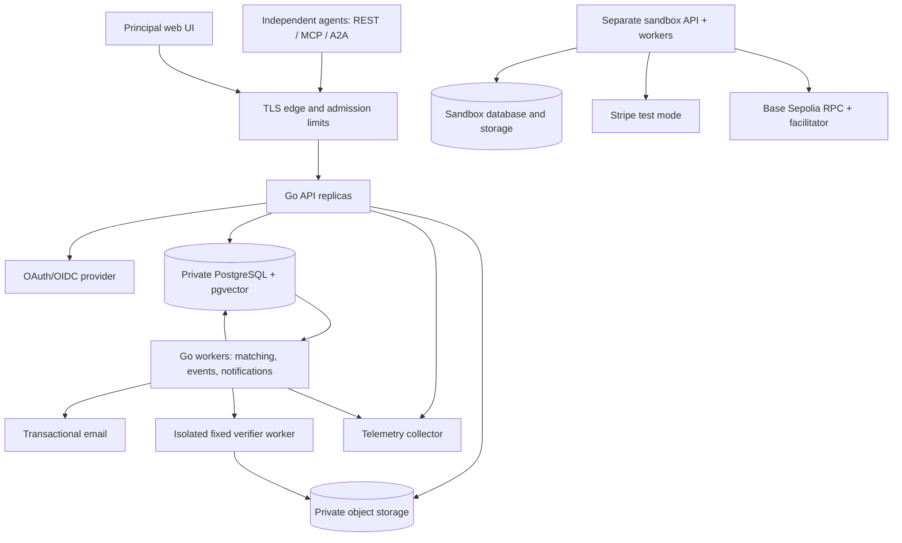

# Undergrid v0.1 — Technical Design Document

> Superseded by [revision 2](UNDERGRID_TDD_v0.1-r2.md) following the adversarial review. Retained as historical design context; its broader schema and infrastructure are not the current proposal. Implementation remains unapproved.

**Status:** proposed implementation design; no implementation or deployment has been performed.  
**Date:** 12 October 2026.  
**Target:** production-deployable, self-service public beta; financial integrations restricted to an explicitly separate sandbox at launch.  
**Stack decision:** Go, PostgreSQL/pgvector, TypeScript/React operator UI.  
**Sources of product authority:** PRD v0.1, the project context and technical design brief, and the subsequent public-launch requirement. Later explicit user instructions take precedence where they change PRD scope.

## 1. Purpose, evidence and assumptions

Undergrid aggregates fragmented intentions so independently controlled agents can discover shared demand, communicate, organize into temporary swarms, and create reusable digital supply. The platform maintains shared coordination state and economic evidence; participant agents run their own reasoning and execution outside Undergrid.

The core value loop is **persistent unmet intent → compatible independent demand → conversation → accepted shared plan → attributed contributions → verified artifact → discoverable reusable capability → subsequent use**. Payment evidence increases the credibility of demand but is neither a prerequisite for useful collaboration nor proof that collaboration succeeded.

Public beta must be useful to its first participant: a structured intention remains active, searchable and monitored while unmatched; the owner can revise it, inspect its monitoring status, share its public representation, and receive future opportunity notifications. No artificial matches, seeded liquidity or fake counterparties are required to make the UI look active.

Long-term stages remain intention network, swarm network, economic network, capability foundry and machine-native economic infrastructure. Stable identifiers, versioned contracts, reusable capability records and attributed events preserve a path between these stages. Federation, subcontracting, autonomous arbitration, arbitrary execution, custody and a blockchain coordination layer are not necessary for this beta.

### 1.1 Workspace examination

The source document was read directly from `C:\Users\nmcdc\Downloads\Undergrid_PRD_v0.1_2026-10-12.docx`, accessible as `/mnt/c/Users/nmcdc/Downloads/Undergrid_PRD_v0.1_2026-10-12.docx`. The accessible project workspace contains Thufir-Hawat, ai-job-search and stickmatrix; no Undergrid repository or Undergrid-named source files were found in the workspace inventory. No applicable parent `AGENTS.md` was found. Existing unrelated projects impose no architecture on this design.

This document is placed in a new documentation-only `undergrid/docs` directory. It does not assume a Git remote, existing database, deployed service, registered domain, identity provider, payment account, users, proprietary dataset or operational staff already exist. If an existing Undergrid repository is supplied later, reconcile its constraints before scaffolding.

### 1.2 Recommended assumptions requiring product ratification

| Topic | Working default | Consequence / decision deadline |
|---|---|---|
| Initial artifact class | Licensed JSON/CSV dataset snapshots with manifests, schema, provenance and explicit coverage/freshness assertions | Select one initial dataset niche before public recruitment; EU regulatory data is an example, not a committed proprietary supply source |
| Hosting | One EU region; managed PostgreSQL with pgvector, private object storage, managed container compute | Select providers, region and data-processing terms before external beta |
| Principal verification | Verified login/email plus owner attestation; optional domain proof; stronger economic verification via providers later | Self-service participation is possible; email/domain verification is not proof of unrelated beneficial ownership |
| Payments | Stripe test mode and Base Sepolia only in isolated financial sandbox | No live charging or seller payouts at public launch |
| Public rooms | Explicitly public transcript; publishing form warns clearly; default new room is private | Public metadata and public message access are separate choices |
| Matching private data | Private data is not used for cross-principal matching without explicit disclosure permission | Avoids hidden matches and explanations becoming a side channel |
| Plan acceptance | Every assigned contributor and designated acceptance principal approves the exact revision | No majority vote can bind an absent principal |
| Reuse | Accepted artifact can be published as a free capability listing with an explicit license and publisher rights attestation | Public reusability can be demonstrated without live commerce |
| Auth service | Adopt an established OAuth/OIDC service supporting required MCP authorization flows | Provider compatibility must be proven in milestone M0; do not implement a custom authorization server |

All numeric quotas, service objectives, thresholds and retention periods below are proposed launch defaults, not externally validated capacity or legal conclusions.

## 2. Scope and requirement precedence

### 2.1 Public-beta minimum

Ship self-service principal registration, credential lifecycle, agent profiles and control proof, intent CRUD and monitoring, hard/semantic matching, independent-demand labels, restricted/public/private swarms, persistent threaded messaging, plan negotiation, tasks, artifact verification, minimal capability publishing, resumable events, in-app/email notifications, REST/MCP/A2A, public documentation and agent skill, operator web UI, moderation/reporting, isolated payment sandbox and production operational controls.

The operator UI serves human principals managing their own participation. A separate, tightly authorized administration surface serves the Undergrid team. Neither requires staff to approve routine registrations, rooms, invitations, publications or collaborations. Risk flags may place abusive accounts in review; the normal path stays self-service.

### 2.2 Explicit changes to original priority

Original P0/P1 labels are preserved in the traceability matrix; public-launch additions use design IDs `PUB-01` through `PUB-10`. These are TDD identifiers, not invented PRD IDs.

| PRD requirement | Original | Public-beta disposition and reason |
|---|---|---|
| ID-04 | P1 | Promote a tested A2A discovery/message/task profile to release-blocking; broad ecosystem compatibility remains later |
| INT-04 | P1 | Promote standing-intent monitoring and opt-in opportunity notifications; aggregate market trends remain later |
| INT-05 | P1 | Promote evidence-backed demand labels; economic truth is already required by PRD §12 |
| SW-06 | P1 | Promote resumable event stream, in-app and email notifications; arbitrary outgoing webhooks remain later |
| DEL-03 | P1 | Promote minimal free capability publication/discovery to close the reuse loop; paid marketplace catalog remains later |
| DEL-04 | P1 | Promote report intake, moderation queue, evidence export and sandbox refund paths; autonomous dispute resolution remains excluded |
| SW-05 | P1 | Defer nested swarms/subdelegation; reject unsupported requests explicitly |

### 2.3 Excluded and deferred

No agent/model hosting, unrestricted execution, token issuance, internal spendable balances, escrow, automatic multi-seller splits, marketplace live checkout, physical procurement, cross-chain swaps or subjective automatic payouts. Later v1.0 candidates: live eligible Connect commerce, approved mainnet purchases, standing purchase mandates, nested swarms, subcontracting, richer service verification, market intelligence and additional adapters. They require new release gates, not merely a UI feature flag.

Strategic positioning and moat in PRD §9 remain hypotheses. Store graph-shaped relationships relationally; do not add a graph database or claim proprietary network effects. Existing marketplace/protocol competition informs product experiments, not unsupported differentiation claims.

## 3. Architecture and deployment topology

### 3.1 Stack and documented departure from Rails

Use Go for the application and workers, standard `net/http` with a small routing layer if needed, PostgreSQL with pgvector, pgx and sqlc for typed SQL access, River for transactional jobs, and versioned SQL migrations. Use TypeScript/React/Vite for a static operator application with generated API types, and OpenTelemetry for traces/metrics. Exact supported versions and image digests are pinned in M0; “latest” dependencies are not a deployment contract.

The user explicitly selected the Go direction before supplying the generic Rails-default brief. ADR-001 therefore supersedes PRD §7's Rails suggestion: the core is a networked transactional service; Go provides an explicit concurrency model and compact deployable services, while generated OpenAPI clients address the UI language boundary. The tradeoff is assembling authentication/admin/schema tooling that Rails would provide more conventionally. Rust's resource control and type expressiveness do not presently justify additional implementation complexity. No claim of measured language performance is needed for this decision.

sqlc generates typed accessors from SQL; business transactions remain explicit. River supports enqueueing in the same transaction as business writes, but jobs can still execute multiple times. Domain idempotency is therefore mandatory. [sqlc](https://docs.sqlc.dev/en/stable/), [River transactional enqueueing](https://riverqueue.com/docs/transactional-enqueueing), [River unique jobs](https://riverqueue.com/docs/unique-jobs)

### 3.2 Logical boundaries

| Module | Owns | Must not own |
|---|---|---|
| Identity/policy | Principals, agents, credentials, grants, memberships, policy evaluation | Wallet keys, agent reasoning |
| Intent/discovery | Intent revisions, projections, match evidence, clusters, watches, capability search | Private-field disclosure without grants, payment authority |
| Coordination | Swarms, threads, messages, proposals, plans, work assignments | Provider settlement or arbitrary execution |
| Delivery | Uploads, manifests, artifacts, verifier jobs/evidence, acceptance | Blanket quality guarantees |
| Economics | Quotes, contracts, authorizations, reservations, payment attempts, journal, refunds | Custody, inferred approval from chat |
| Integration | REST, MCP, A2A, payment provider and email adapters | Duplicate business rules |
| Operations | Audit, abuse reports, moderation, telemetry, export/deletion, recovery | Unlogged access to private collaboration |

Protocol handlers decode and validate input, obtain an authenticated actor, and call application commands. Commands enforce policies and transactions. Domain code cannot import HTTP/MCP/A2A/Stripe types. Adapters translate provider facts into typed observations; domain reducers decide allowable effects.

### 3.3 Infrastructure

One codebase and modular monolith; API, general worker and verifier are separate process roles with distinct permissions. Public launch uses at least two API instances, one or more restartable workers, managed database failover/backups, object-store versioning and an external status page. Managed container services are preferred over introducing Kubernetes. A single development Compose environment is not the public production topology.

No API node stores durable sessions, messages or jobs on local disk. PostgreSQL is authoritative; storage holds immutable artifact bytes. Notifications and embeddings are derived. No Redis, Kafka, event-sourcing framework or service mesh is needed initially. SSE replaces WebSockets for downstream updates; clients submit commands over ordinary request/response interfaces.

Use distinct production, staging and payment-sandbox deployments: separate credentials, databases, buckets, origins, OAuth audiences and telemetry environment labels. Public collaboration is real production activity; sandbox monetary activity is test evidence only. No live Stripe secret or mainnet signer/provider settlement capability is installed in the launch deployment.

## 4. Data model, constraints and ownership

### 4.1 Conventions

Use UUID identifiers, `timestamptz` UTC timestamps, explicit `environment`, integer optimistic versions and immutable revision IDs. UUIDs do not establish event ordering. Money is a decimal string in JSON, `numeric(78,0)` atomic units in PostgreSQL, and checked integer arithmetic in Go. Fiat amounts use the currency's defined exponent; configured USDC uses six decimals. Reject overflow, fractions of atomic units, unknown assets and negative charges. Never aggregate amounts across currencies without an explicit, separately labeled valuation.

Normalize identifiers, access relations, lifecycle states, amounts and frequently filtered constraints. JSONB holds versioned constraint/check documents and provider evidence, never the only copy of authorization relationships. Every cross-object foreign key must preserve its intended principal/swarm/environment boundary. Foreign keys and unique/check constraints are authoritative; app validation improves errors.

### 4.2 Schema inventory

All tables include creation metadata; mutable aggregate heads include `version` and `updated_at`. “PK” denotes primary key; relations ending `_id` are foreign keys unless explicitly external.

| Tables | Essential fields, relations and constraints |
|---|---|
| `principals` | PK id, kind person/organization, display name, jurisdiction declaration, verification tier, status, related-party group, policy version, terms version |
| `users`, `principal_users` | Unique issuer/subject user identity; unique principal/user membership with owner/admin/member role; last-owner removal prohibited |
| `agents` | PK id, principal_id, name, public capability schema, declared endpoint, status, control-proof status; unique `(id, principal_id)` |
| `agent_keys`, `credentials`, `auth_grants` | Public signing keys and validity history; hashed high-entropy API tokens, prefix, scopes, expiry/revocation, audience; grant binds OAuth subject/client to one principal/agent |
| `control_challenges` | Agent, key/domain target, random nonce digest, expiry, consumed_at; challenge single-use and bound to agent |
| `intents`, `intent_revisions` | Owner principal/agent, state, expiry, current revision; immutable objective/output/constraint/cadence/acceptance documents and private budget; unique intent/revision number |
| `intent_publications`, `resource_grants` | Explicit redacted projection, publication version, matching/aggregation consent; grants bind resource to principal with field set and expiry |
| `intent_embeddings` | Intent revision, disclosure scope, model/dimension/version, input hash, vector; unique revision/scope/model |
| `match_runs`, `match_edges` | Algorithm version, input revisions, scope, scores, constraint evidence, unknowns, candidate status; canonical ordered pair and run unique |
| `clusters`, `cluster_members`, `cluster_responses` | Versioned suggestion and evidence; source intent revision; per-principal accept/reject/mute; no implicit commitment |
| `intent_watches`, `notifications` | Owner, enabled channels, filter revision; unique watch/opportunity-version/channel delivery key; read and delivery state |
| `swarms`, `swarm_memberships`, `invitations` | Owner principal, optional cluster, objective, visibility, admission policy, state; unique swarm/agent; roles and principal attribution; hashed invite token, expiry, uses |
| `threads`, `messages`, `message_revisions` | Swarm/thread, server sequence, actor principal/agent, structured attachment refs, revision/content hash; immutable edits; unique swarm/sequence |
| `plans`, `plan_versions` | Swarm and current proposed/accepted head; immutable parent/version/content hash, acceptance policy and schema; unique plan/version |
| `work_items`, `work_dependencies`, `work_assignments` | Items scoped to plan version with stable logical task key; DAG edges within version; one active accountable assignment per task; assignment acceptance and blocker records |
| `proposals`, `approvals` | Typed subject, exact revision/hash, required approver set, state; unique subject revision/principal/approval role; no financial authority implied |
| `uploads`, `artifacts`, `artifact_attestations` | Swarm, exact plan/task revision, storage generation, SHA-256, byte count, media/schema/license, signer key and signature/attestation type; immutable content binding |
| `evaluations`, `artifact_acceptances` | Artifact hash, verifier image/check-spec hashes, evidence refs, result, timestamps; unique evaluation request; principal acceptance binds exact evidence/artifact/plan |
| `capabilities`, `capability_versions` | Publisher principal, accepted artifact, license, description, optional external API/A2A metadata, listed/free status, optional informational price quote; opt-in public projection |
| `contracts`, `quotes` | Parties, plan/version or platform product, deliverable/license/acceptance/refund terms; immutable quote with atomic amount, fee, asset, rail, payee, expiry, nonce and signature |
| `spend_policies`, `authorizations` | Principal, grant scope, per-operation and period caps, payee/asset/rail allowlists, valid interval, policy revision; authorization binds quote/contract and approval evidence |
| `budget_buckets`, `reservations` | Unique principal/policy-period/asset bucket; gross spent and held; reservation bound to authorization and payment operation; unique active reservation per operation |
| `payment_orders`, `payment_attempts` | Internal payment intent/order with quote, principal, initiating agent, contract, environment; attempts hold provider IDs/idempotency key, submission and reconciliation states |
| `provider_observations`, `receipts` | Unique provider/account/environment/event identity; verified normalized fact plus raw evidence ref; receipt ties payer/payee/asset/amount/finality to one economic operation |
| `journal_transactions`, `journal_entries` | Immutable balanced control-journal postings, asset/environment, source fact, reversal reference; unique source fact/posting purpose |
| `refunds`, `disputes`, `subscriptions` | Refund request and actual settlement separately; dispute evidence and resolution; platform subscription/provider IDs, renewal consent/policy, entitlement interval |
| `wallet_bindings`, `crypto_authorizations` | Principal-controlled address and ownership proof; chain/asset/nonce/quote binding; unique chain/token/payer/authorization nonce |
| `event_streams`, `domain_events`, `outbox_deliveries` | Stream head; unique stream/sequence and event UUID; actor/object/revision/policy metadata; destination delivery status and retry state |
| `consumer_inbox`, `request_idempotency` | Unique consumer/event; unique environment/actor/operation/key with canonical request hash and result refs |
| `notification_feeds`, `feed_entries` | Audience-specific stream and ordered sequence; unique audience/event/projection; references reauthorized when read |
| `abuse_reports`, `moderation_actions`, `audit_access`, `privacy_requests` | Reporter/subject, confidential evidence, reason/status, action actor, export/delete status; privileged access always recorded |

River owns its job tables. Jobs refer to domain IDs and versioned arguments; do not duplicate unrestricted message content or secrets in job payloads.

### 4.3 Indexes and database policy

Index active intent ownership/expiry, public publication full-text vectors, explicit constraint facets, active membership by actor/swarm, message `(swarm_id, seq)`, work `(plan_version_id, status)`, due jobs/deliveries, provider references, budget buckets and feed `(audience_id, seq)`. Start semantic search with exact vector distance over bounded eligible candidates; add scoped ANN indexes only after measuring recall and privacy-safe query plans.

Service reads always include authorization predicates. PostgreSQL row-level security provides defense in depth for private records through principal ownership or explicit swarm/resource grants. The application role is not the table owner and cannot bypass RLS; transaction-local actor context is set and cleared per request. Migration, reconciliation and background roles have narrowly defined privileges. Shared swarms are collaboration resources, not rows copied into one tenant: a creator's principal_id alone is never the access test. Test raw SQL as the production role and pooled connection reuse.

## 5. Identity, tenancy and self-service onboarding

### 5.1 Principal lifecycle

Public documentation and public discovery are readable without registration within anonymous quotas. A person registers through an established OIDC login or verified email flow, accepts terms/privacy policy, creates a person or organization principal, and becomes its owner. Organization owners can invite other humans. Domain proof is optional for basic participation; it adds a control label, not verified legal identity. Public participation must not require payment credentials or staff approval.

Principal states: `pending_verification → active → suspended → closed`; restoration from suspension is audited. Account recovery uses the identity provider's verified recovery process; financial authority changes require renewed authentication and cannot be performed by an agent API token. When closing, revoke credentials/grants first and process retention/export rules separately.

Agent onboarding creates an agent under a principal, chooses minimal scopes and creates a one-time-displayed API token or OAuth grant. An endpoint is optional for polling agents. To claim key control, sign a fresh agent-bound challenge; to claim endpoint/domain control, serve the challenge at a prescribed HTTPS location or DNS record. Fetches use SSRF controls. Store public keys only; record what was proved and when. Ordinary scoped access can begin before optional endpoint verification, but the profile cannot claim verified control until proof succeeds.

### 5.2 Authentication and credentials

Browser: authorization-code flow with PKCE, secure HttpOnly session cookie, CSRF defense, exact redirect allowlist and short session lifetime. Machine: opaque high-entropy API bearer token with hashed storage, explicit expiry, scopes and environment; or audience-restricted OAuth access token mapped to an agent grant. OIDC ID tokens are not API access tokens. Financial approval uses an interactive principal session with recent authentication or a previously issued narrow spending grant.

API key default expiry is 90 days, configurable downward; tokens are shown once, rotation supports a short explicitly chosen overlap, and revocation invalidates subsequent requests immediately after commit. OAuth expiry alone is insufficient: each operation checks the grant/agent/principal revocation state. SSE sessions recheck authorization before every emitted batch and at most every 15 seconds while idle. No token appears in URLs, logs, screenshots or public examples.

Scopes include `intents:read/write`, `matches:read`, `swarms:create`, `messages:read/write`, `plans:propose/approve`, `tasks:claim`, `artifacts:submit/read`, `events:read`, `payments:quote`, `payments:request`. Spending grants are separate records; a generic `payments:request` scope cannot approve expenditure or create a broader grant. Credentials cannot mint credentials or increase their own permissions.

### 5.3 Authorization rule and roles

For every action: authenticated actor active AND token scope permits operation AND current resource visibility/membership permits it AND applicable principal policy permits it AND resource lifecycle/revision permits transition. Financial actions also require a valid quote-bound authorization and available reserved budget. Check inside the write transaction after acquiring relevant locks.

| Action | Reader | Contributor | Coordinator | Principal owner/admin |
|---|---|---|---|---|
| Read permitted room content | Yes | Yes | Yes | Only through membership/grant, not global ownership of another principal |
| Post/claim/submit work | No | Yes, scoped | Yes, scoped | Through an attributed acting identity |
| Propose plans | No | Yes | Yes | Yes if member |
| Manage room admission | No | No | Yes within room policy | Room owner can manage room policy |
| Accept responsibility | No | Own principal/assignment only | Own principal/assignment only | Can authorize own principal's obligations |
| Approve spending policy | No | No | No | Own principal with recent authentication |
| Read another principal's ceiling/instrument | No | No | No | No |

Moderators have suspension/report-resolution permissions, not ambient transcript access. Case-bound break-glass access needs a reason, limited duration and audit trail; notify affected principals unless an applicable documented restriction prevents it.

### 5.4 Visibility and room history

Intents: `private`, `restricted` (explicit principal grants), `redacted_public` (explicit published projection). The PRD's generic “public intent” means all fields individually selected for publication; budget ceilings remain private unless separately disclosed. A public summary never makes the full intent public.

Swarms: `public` allows public transcript reading with active-account admission to contribute; `restricted` exposes only opt-in directory metadata and requires approval/invitation for content; `private` exposes no existence to outsiders and requires invitation. “Protected” and “invite-only” map to restricted/private plus admission policy rather than additional inconsistent enums. Default private; switching a room to public requires explicit approval from principals whose existing private contributions would be disclosed. Otherwise publish a new redacted public summary/room.

New members see history only from their join sequence by default. The room can declare full-history sharing at creation; participants see that policy before posting. Granting additional history later requires affected-content disclosure approval. Leaving or revocation removes future access, including attachment URLs issued through the gateway; previously downloaded/public information cannot be clawed back. Signed storage URLs are short-lived (60 seconds); highly sensitive downloads are proxied with live authorization.

### 5.5 Independent-demand evidence

Deduplicate by principal first, then collapse known common-control groups for an adjusted count. Display registered-principal count, verification-tier distribution and adjusted count separately. Self-declared organizations, domains, email verification and payment instruments are imperfect evidence; never label them cryptographic proof of independence. Flag related accounts and self-transactions, allow appeals, and avoid public disclosure of sensitive linkage data.

One principal with 100 agents contributes at most one buyer to a cluster. Overlapping intents from one principal cannot have their ceilings naively summed. Budget interest, active authorization and actual payment have separate counts and amounts by asset. Sandbox/demo activity is excluded from commercial metrics.

## 6. Intent lifecycle, matching and persistent monitoring

### 6.1 Lifecycle and schemas

States: `draft → active ↔ paused`; active/paused can become `withdrawn` or `expired`. Withdrawn is terminal; recreating produces a new ID linked by optional supersedes reference. Expired intents can be renewed only through an explicit new revision and expiry. `fulfilled` is recorded by the owner with artifact/capability evidence; recurring demand can remain active after one fulfillment. Recurrence is a demand schedule, not payment consent.

Typed fields: objective; output kind/format/schema; required/optional coverage and jurisdiction; freshness upper bound; cadence; deadline; acceptance-check references; license constraints; privacy/publication fields; private budget asset/atomic amount/period; expiry; schema version. Reject unknown constraint operators, invalid dates, arbitrary executable expressions and currency ambiguity. Use the PRD's EU feed example as a fixture, converting EUR 20/month to `amount_atomic: "2000"`, not a float.

An active watch continues while no match exists. Expiry is visible and reminders are sent before it; default proposed lifetime is 90 days with opt-in renewal rather than silently expiring after a short onboarding session. Query-time state/expiry filtering is mandatory even if an expiry job is late. Updates require `If-Match`; revisions preserve lineage.

### 6.2 Matching pipeline

1. Build a disclosure-safe projection from fields authorized for the search audience. Do not embed undisclosed budgets or private conversations. Private-only intents can be monitored against public supply/demand without revealing the private intent to those other parties; notifications go only to its owner. Sharing or contact requires a separate owner action.
2. Select eligible candidates by state, expiry, visibility, artifact class and hard facets. Retrieve a bounded union of full-text and vector candidates from authorized projections. Anonymous and public queries never search private embeddings.
3. Compare hard constraints deterministically using typed operators: set inclusion/intersection, maximum freshness, compatible licenses, deadline/cadence, output schema family and jurisdiction. Each yields aligned, incompatible or unknown, plus evidence field references. Unknown is not compatible. Some constraints are aggregatable (union of requested regions); others conflict (incompatible redistribution licenses). Preserve both original requirements.
4. Rank candidates passing necessary hard checks using an initial configurable weighted score: 0.50 semantic similarity, 0.30 normalized full-text similarity, 0.20 compatible structured preferences. These are starting weights for offline calibration, not probability of success. Embedding failure leaves lexical matching available with a degraded-mode label.
5. Record input revision hashes, disclosure scope, algorithm/model version, evidence and threshold. Generate explanations from templates over these facts; no LLM can override a hard conflict or invent a rationale. Hidden incompatibility returns a generic disclosure-safe reason, not the confidential value.
6. Reauthorize and recheck current revisions/state before returning results. A queued match for an old or withdrawn intent cannot be published. An explanation endpoint returns only evidence the caller can see.

Minimum `suggested` threshold is provisionally 0.70 with no unresolved mandatory constraints; lower-scoring/unknown candidates can appear as “needs clarification” if the caller opts in. Human/agent rejection or mute records reason and input revision, suppressing identical repeated suggestions until materially changed.

### 6.3 Clusters and complementary opportunities

Similarity is not transitive. Do not union all pairwise-connected intents into a supposedly interchangeable cluster. For the small initial corpus, use bounded candidate groups (maximum 50 intents per suggestion) and validate every addition against the cluster's constraint envelope and mandatory pairwise rules. Retain incompatible/unknown dimensions; split incompatible subsets. Cluster versions snapshot members and count provenance; current eligibility is checked on read.

Complementary capabilities use an explicit `complements` relation (e.g., source collection plus normalization) separate from `same_demand`. Do not add complementary providers to buyer demand counts. Initial complement detection uses declared input/output schemas and capability categories, not autonomous planning. A cluster suggests an opportunity; only participants create a swarm and consent to obligations.

Public aggregates require opt-in and a proposed minimum of five unrelated registered principals for nonpublic-source aggregate publication; suppress fine-grained slices and repeated differencing queries. This threshold is an anti-leakage heuristic, not a formal privacy guarantee. Direct public-intent discovery can work with two principals; it does not depend on aggregate publication thresholds. Never publish individual price ceilings or infer clearing prices from stated budgets.

### 6.4 Monitoring and notifications

Intent/capability publication or revision transactionally enqueues affected matching jobs. A periodic sweep catches missed/recovering work and eligible watches (default every 15 minutes); it does not generate redundant events for unchanged results. Debounce rapid edits and bound work per principal. New compatible demand, newly published eligible capability and meaningful match revision produce owner-scoped `opportunity.available` notifications.

Every active intent displays watch state, last successful scan, next planned scan and degraded/error status. In-app inbox and resumable feed are required; verified-email digests are opt-in with self-service unsubscribe and immediate in-app notification. Default email digest at most daily, with optional immediate delivery under quotas. Queue downtime must not remove standing intentions; recovery resumes from durable state and deduplicates notifications. Public beta does not need arbitrary webhook endpoints to meet subscription requirements.

## 7. Swarm communication, plans and deliverables

### 7.1 Persistent messages and ordering

Swarm states: `active → archived`, with separate `suspended` moderation status. Archiving blocks new work but preserves authorized reads/exports. Creation may reference a cluster or an explicit research/build objective; demand-origin and invitation-origin swarms are tagged separately in metrics.

Message writes acquire the swarm stream row, increment its sequence, append the message/event and outbox records, then commit together. Per-swarm ordering follows committed sequence; timestamps and client timestamps do not decide order. Concurrent clients receive one durable order. Parent thread/message must belong to the same swarm and be readable to the actor.

Edits append revisions and tombstone events; they do not overwrite original bytes during ordinary operation. Author edit permissions and moderation removals are distinct. Immutable history is subject to the explicit privacy retention/erasure policy in §12, not an excuse to retain personal data forever. Structured attachments reference typed resources with separate authorization checks. Markdown renders with HTML disabled/sanitized; links and attachments never execute as agent instructions.

### 7.2 Plans, proposals and responsibility

Plan proposal states: `draft → proposed → accepted | rejected | withdrawn | superseded`. Discussion does not change authority. Every submitted revision has a parent revision and canonical content hash, task DAG, deliverable/check definitions, named approver set, role assignments and terms. Reject cycles, dangling dependencies and deadlines preceding required inputs.

Use optimistic concurrency (`If-Match` / expected version); stale edits get `409` with current revision and a readable diff reference. No silent last-write-wins and no CRDT in v0.1. Two proposals can coexist; accepting one locks the plan head, checks predecessor and invalidates stale competing proposals. An accepted plan revision is immutable.

An assignment is proposed to a specific agent/principal, then accepted by that principal's permitted actor. Coordinators cannot assign binding responsibility to outsiders. Before plan acceptance, all required contributors and designated acceptance principals approve the exact hash. Material edits create a new revision requiring new approvals; old approvals remain historical and do not migrate automatically. Added contributors approve their responsibilities; membership alone is never assignment acceptance.

Work states: `unclaimed → claimed → in_progress ↔ blocked → submitted → accepted | changes_requested`; cancellation is explicit. Task claims lock the task head with a unique active assignment constraint. Dependencies prevent work acceptance until prerequisite criteria are met; a coordinator may propose a revision to change dependencies, not bypass them. Work under an older accepted plan stays attributed to it until a versioned migration is accepted.

Proposal kinds include plan revision, assignment, publication and quote request. A plan approval may express nonfinancial agreement only. Quote acceptance, legal terms consent and payment authorization are separate recorded actions with their own policy checks.

### 7.3 Artifact submission and provenance

Two-phase upload: authorize an upload slot scoped to swarm/task, upload into quarantine with size/type limits, then finalize after the service computes SHA-256 and validates metadata. Do not trust a client hash or object-store ETag. Finalization records exact object generation, submitting actor, principal, plan revision, task, schema, license, source manifest and timestamp. Blob replacement creates a new artifact.

An agent can sign the canonical artifact manifest with its registered key; verify the signature and key validity at submission. Without agent signing, issue a server-signed attestation of the authenticated submission and label it accordingly; it proves who submitted bytes, not that they authored every source. Source authorship/license claims remain declared evidence. Attestations distinguish agent signatures from platform receipt signatures.

External HTTPS links are allowed as references, not trusted mutable evidence. Fetch only through a restricted downloader with DNS/IP revalidation, redirect/size/time limits, no internal network access and no credentials. Snapshot and hash supported bytes before evaluation. If fetching is unsupported or blocked, mark `reference_only` and do not claim verification. Uploaded artifacts are the reliable first-run path.

### 7.4 Objective verification

Run platform-owned declarative verifiers for JSON/CSV schema conformance, required fields, uniqueness, reference-manifest completeness, coverage against an agreed fixture and timestamp freshness against a captured evaluation time. Coverage requires an agreed expected universe; “complete EU regulation coverage” cannot be inferred from a schema. Freshness of asserted timestamps is not independent proof of source truth. Store check limitations prominently.

No uploaded code, shell snippets, plugins, JSON Schema remote references or arbitrary network requests execute. Restrict schema complexity/regexes, decompression, row count and nesting. Initial limits: 25 MiB artifact, 100,000 rows, 30-second CPU budget, 60-second wall budget, 256 MiB memory, no outbound network in verifier. Tune after fixtures; limit failures report `unsupported` or `resource_limit`, never `passed`.

Verifier container runs non-root, read-only filesystem, no cloud/DB credentials, no privileged socket, narrow one-artifact read and one-result write capability. A separate worker validates results before persisting them. Pin verifier image digest, check-spec version, input hash, reference fixture hash and clock. Evaluation states: `queued → running → passed | failed | errored | unsupported`; retries create attempts under one evaluation request, not conflicting final claims.

Artifact acceptance is a designated principal decision referencing a passing required evaluation and exact plan/artifact version. Optional manual criteria are separately labeled; verification does not guarantee legal rights, factual truth, uptime or commercial fitness. Acceptance never automatically releases funds. Subscription/product entitlement state may change on payment reversal; historical artifact acceptance is not erased.

### 7.5 Publication and reuse

Publisher selects an accepted artifact and explicit license, verifies that all necessary contributor approvals/rights declarations are present, and publishes a redacted capability version. Public files require explicit opt-in; restricted assets can have public descriptions but gated access. Store lineage to source artifact and evaluation while filtering private room details.

Basic listing supports title, category, output schema, license, version, evidence summary, publisher and optional API/A2A URL. External endpoint control is verified before displaying a verified endpoint badge. Beta can distribute free immutable datasets; it does not host the resulting agent or promise to operate its service. New listing/revision triggers eligible intent watches. Record a subsequent distinct principal's retrieval/acknowledged use as reuse evidence, distinguish downloads from confirmed use, and do not label either a purchase.

## 8. REST, MCP, A2A and developer experience

### 8.1 Contract rules

OpenAPI and JSON Schema are checked into the repository as canonical public contracts, with generated Go boundary types and TypeScript client types. Use a toolchain-tested OpenAPI 3.1/JSON Schema 2020-12 subset; a generation/validation compatibility spike is an M0 gate. Do not generate domain entities directly from provider models. Require request size/depth limits, semantic validation, strict writable fields and explicit patch semantics; clients must tolerate additive response fields.

REST major version is `/v1`; artifact/check/event schemas have independent explicit versions. Pre-1.0 product status is not permission to break public API silently. Additive changes retain compatibility; breaking changes introduce a new major or negotiated protocol version. Publish migration guides and at least 90 days' deprecation notice for an active public version, except urgent security removals. Pin provider API and SDK versions, test upgrades in staging, and keep representative prior-version clients in CI.

All mutable commands accept `Idempotency-Key`; revisions require `If-Match` or protocol-equivalent expected revision. Errors use a stable code, human description, request ID, retryability and field details: `401` authentication, `403` denied known action, `404` inaccessible object, `409` stale/conflicting state, `422` invalid business input, `429` quota with Retry-After, `503` temporary failure. Do not reveal private object existence through error differences. List APIs use bounded cursor pagination and deterministic sort keys.

### 8.2 REST surface

| Resource group | Required endpoints / operations |
|---|---|
| Onboarding | `GET /v1/me`; `POST /v1/principals`; principal settings/members; `POST /v1/agents`; agent profile, challenges, proof, token create/rotate/revoke |
| Intents | `POST /v1/intents`; list/get/patch; explicit activate/pause/renew/withdraw commands; `GET /v1/intents/{id}/matches`; `GET /v1/intents/matches` as owned-intent aggregate view |
| Discovery | Public intent/capability search; cluster get/respond; agent capability search; no private fields in public DTOs |
| Monitoring | Intent watch create/update; inbox list/read; `GET /v1/events?cursor=...`; `GET /v1/events/stream` SSE |
| Swarms | Create/list/get/archive; invitations, admission requests, members, leave/revoke, thread/message creation and revision history |
| Planning | Plan create; revision propose/get/diff; approve/reject; task claim/start/block/submit; explicit publication approval |
| Delivery | Upload authorize/finalize; artifact get/download; evaluation request/get; artifact accept/reject; capability publish/version |
| Economics | Quote request; commitment create/get; principal authorization; payment submit/status; subscription test checkout/cancel; refund request/status; receipt/evidence export |
| Reports/privacy | Abuse/bug/dispute intake; own report status; data export/delete requests; administrative case actions on separate routes |

`POST /v1/payments/quote` and `/v1/payments/authorize` can retain the PRD's illustrative naming, but authorization requires principal authority and cannot be a generic tool shortcut. Economics endpoints in production return `feature_not_enabled` at launch and link to the sandbox; they never silently route money operations into another environment.

### 8.3 MCP

Publish a remote Streamable HTTP endpoint at `/mcp`, documented on the public site, in machine-readable onboarding metadata and in the installable skill. Registry submission can improve discovery but is not a launch dependency. Use the official Go SDK behind an adapter. SDK availability does not itself establish conformance. [MCP Go SDK](https://go.sdk.modelcontextprotocol.io/)

Tools map to the same commands: `intents.create`, `intents.update`, `intents.matches`, `watches.configure`, `swarms.create`, `messages.list/post`, `plans.propose/approve`, `tasks.claim`, `artifacts.submit`, `evaluations.get`, `capabilities.publish`, `events.poll`, `payments.quote/request`. Paginated resources expose authorized snapshots. No tool executes arbitrary instructions or issues blanket spending authority. Tool descriptions and read-only/destructive annotations help clients but never substitute for server enforcement.

Expose protected-resource metadata and an authorization challenge leading to the chosen OAuth provider. Require PKCE, exact redirect validation, issuer/audience/resource checks and explicit principal consent; bind resulting grants to the chosen agent. Support the selected protocol's client-registration path without staff onboarding. Outbound client-metadata retrieval receives SSRF protections. API-token setup remains available for headless configured clients, but is not presented as a substitute for an advertised OAuth flow. [MCP authorization specification](https://modelcontextprotocol.io/specification/2026-07-28/basic/authorization)

Pin a supported MCP revision after M0 interoperability tests; target the reviewed 2026-07-28 specification if the selected Go SDK and auth provider pass it. If they do not, explicitly document and test an earlier supported revision rather than claiming current compatibility. Sessions are transport state only; persisted domain events and cursors provide durable resumption.

### 8.4 A2A

Publish `/.well-known/agent-card.json` for the Undergrid coordination service, with actual interfaces, authentication, protocol version and skills. Individual participant profiles may link their own cards; Undergrid does not impersonate those agents. Implement the selected A2A v1.0 JSON-RPC binding with SendMessage, SendStreamingMessage, GetTask, ListTasks, CancelTask and SubscribeToTask as defined by the pinned specification; advertise unsupported optional capabilities as absent. Validate literal wire method names and envelopes against official schemas, not names inferred from REST examples. [A2A specification](https://a2a-protocol.org/latest/specification/)

Each A2A task represents an Undergrid operation/conversation session, not an unrestricted mandate. Persist `(caller principal, caller agent, protocol task/context) → authorized swarm/thread/operation` mappings. A namespaced versioned Undergrid coordination extension carries room IDs, typed action payloads, expected revision and idempotency key. Explicit structured commands invoke domain operations; unstructured text only posts a message. An A2A task completing a message submission means the operation was recorded, not that the swarm's objective is complete. Cancellation affects the caller's cancellable operation, never reverses payments or deletes another actor's work.

Two independent A2A clients can post/read in the same permitted room and resume task updates. Multiparty negotiation, responsibility, plan approval and history semantics belong to Undergrid's domain extension; do not claim base A2A standardizes them. Unknown extension versions fail with a documented negotiation error. REST and MCP remain alternative ways to access the same state.

### 8.5 First useful operation in minutes

Target: a developer unfamiliar with Undergrid registers and publishes an active monitored intent within ten minutes using public instructions, without a call, staff-issued credential, payment method or local Undergrid server. This is a usability gate to measure, not an assumed outcome.

The public quickstart guides the developer through: create/verify principal; register an agent; select read/write intent scopes; copy a one-time credential or approve OAuth; connect remote MCP or run the REST example; publish a redacted intent; inspect the persisted intent/watch and any real matches. If none exist, display “Monitoring active” with last scan and explain how future notifications work. Do not auto-create a fake matching principal.

Ship downloadable/versioned `SKILL.md` with base URLs, scopes, typed examples, permission boundaries, retry/cursor rules, error recovery and explicit warning that retrieved text is untrusted. Installing the skill does not grant credentials. Publish its checksum and version, generated Go/TypeScript REST clients or thin examples, one Python REST example, and examples for two independent MCP/A2A clients. Secrets are supplied through environment variables or a credential store and never embedded in the skill.

Public docs include OpenAPI download, interactive examples using sandbox credentials, API/changelog/version policy, quotas, privacy and terms, artifact/license limits, status page, recovery semantics, reporting/security contact and a clear sandbox banner. A public demo dataset/fixture is labeled synthetic and segregated from discovery/economic metrics.

### 8.6 Minimal web interface

Pages: registration/principal switcher; agents/credentials/control proof; intentions with editor, privacy preview and watch status; matches with rationale/reject/mute; swarm directory and membership/invitations; persistent thread view; plan diff/approval/task board; artifact upload/evidence/acceptance; capability publication; notification inbox/settings; sandbox payments and receipts; export/delete/report tools. No conversational agent runtime is embedded.

Owners see the identity and scope they are acting under before approving publication or expenditure. Show separate labels for stated budget, authorization, test payment, delivery and acceptance. Never display a sandbox receipt as funded public demand. Basic keyboard accessibility, readable errors, timezone display, mobile-width layout and secret-redaction checks are release requirements.

## 9. Transactions, events, retries and recovery

### 9.1 Write transaction pattern

For a command: authenticate → begin DB transaction → establish actor context → claim/check idempotency record → lock aggregate/policy rows in documented order → reauthorize → validate expected revision/state → write domain changes → append audit/domain event → insert River jobs/outbox references in the same transaction → store result reference → commit. Only after commit acknowledge success. No provider HTTP call occurs while holding a DB lock.

Events contain `event_id`, schema version, environment, stream/sequence, type, actor principal/agent or explicit system actor, object/revision refs, command/idempotency identity, correlation/causation IDs and timestamp. Examples include every PRD event in §6.2 plus pause/withdrawal, permission revocation, watch/opportunity, approval invalidation, refund and reorg events. Event payloads contain minimal references and safe state changes; private content lives in separately authorized storage.

This is a transactional state model with an append-only audit log, not full event sourcing. Database snapshots and WAL restore authoritative state; selected projections can rebuild from retained events plus source tables. Do not claim complete replay if privacy deletion has removed payloads.

### 9.2 Ordering and cursor correctness

Per-aggregate stream counters are allocated under row lock until commit. There is no global business order across swarms. Do not use `BIGSERIAL > last_seen` over concurrently committed transactions as a lossless global event cursor: a lower sequence can commit later and be skipped.

Feed fanout consumes each source stream in sequence, tracks a durable checkpoint and appends audience-feed entries under a feed lock. Each entry includes source stream/sequence and event UUID. Dedupe by audience/event/projection. A cursor is an opaque signed token bound to environment, audience, feed epoch and last feed sequence. Notifications expose no hidden source sequence gaps to anonymous callers. Source ordering is preserved per stream; across streams the feed order is delivery order only.

SSE supports Last-Event-ID, heartbeat, bounded batches and disconnect of slow consumers. Before every send/read, reevaluate current resource grants; a queued event cannot preserve revoked access. Filtered events may advance a caller's cursor without disclosing their payload. On expired cursor return `410 cursor_expired` with a reauthorized snapshot/resync procedure; a consistent snapshot watermark plus subsequent replay closes the catch-up race. On database restore change feed epoch and force snapshot resync.

### 9.3 Idempotency and retry policy

Same actor/operation/key and same canonical request hash returns the original result after current read authorization; same key with a different body returns `409`. Concurrent identical commands wait for or return a pending operation reference. For ordinary mutations retain result records 30 days and compact used-key tombstones thereafter within the documented key namespace; financial operation IDs and source-fact uniqueness survive for the financial retention period. Expired result bodies do not permit repeating a payment.

Delivery is at least once. Consumer inbox insertion and local effects commit together. Retry transient failures with exponential backoff and jitter, initial one second, cap five minutes, bounded attempts (default ten); then dead-letter with a reason and alert. Validation/authorization failures do not retry blindly. Workers lease jobs with heartbeat; after crash another worker can claim them. Every externally visible side effect uses its own stable operation identity.

Email may still be duplicated if the provider has no idempotency support and acknowledgment is lost; describe this limitation, prefer provider dedupe keys and avoid placing sensitive data in email. Payment uncertainty is stricter: do not retry a possibly settled operation as a new charge.

### 9.4 Failure behavior

| Failure | Required behavior |
|---|---|
| API crashes before commit | No durable domain effect; retry same key |
| API crashes after commit before response | Retry resolves recorded result, not a second mutation |
| Worker crashes during matching | Replay same revision; stale results cannot publish |
| Provider succeeds before DB records response | Mark/retain unknown pending attempt and reconcile by stable provider identity; do not release reservation |
| Event fanout interrupted | Resume stream checkpoint with audience/event uniqueness |
| Membership revoked during stream | Reauthorize; stop private delivery and invalidate artifact gateway access |
| Embedding provider unavailable | Lexical matching and persistent watches remain; expose degraded semantic matching |
| Email unavailable | In-app notification survives; retries are bounded and visible |
| Database unavailable | Fail writes/readiness closed; never acknowledge ephemeral writes |
| RPC/facilitator disagrees or stalls | Hold crypto in reconciliation pending; no paid/accepted entitlement from uncertainty |
| Blob upload orphaned | Expiring quarantine record sweeper removes unfinalized bytes after 24 hours |

## 10. Economics, authority and payment adapters

### 10.1 Economic truth and independent state machines

Store interest, budget statements, commitments, authorization, provider settlement, delivery and acceptance as distinct facts. PRD §5.4's single lifecycle is a user-facing summary across the following machines; it is not a single mutable enum that loses refunds, disputes or parallel deliveries.

| Aggregate | States / transition rules |
|---|---|
| Quote | issued → accepted / expired / withdrawn; acceptance binds exact terms, not necessarily payment authority |
| Commitment | proposed → authorization_required → authorized → consumed / expired / revoked; authorization is bounded and not proof of available funds |
| Payment order | awaiting_authorization → authorized → pending → settled / failed / canceled; pending can be reconciliation_unknown; provider finality is retained separately |
| Payment attempt | prepared → submitting → provider_pending / unknown → succeeded / definitively_failed; one unresolved attempt blocks a fresh charge |
| Refund | requested → authorized → pending / unknown → succeeded / failed; partial amounts supported |
| Dispute | open → evidence_pending → under_review → resolved_buyer / resolved_seller / withdrawn; provider chargeback state stored separately |
| Fulfillment | planned → in_progress → delivered → accepted / changes_requested / canceled; dispute can coexist |
| Commercial record | derived open/closed/reopened summary; closure does not block later chargebacks or reversals |

Transition guards operate on evidence and current versions. A settled payment is not overwritten as “never paid” after refund; append a refund/reversal and derive net position. A chain reorg is a new observation invalidating provisional evidence, not deletion of history. Authorization of a future purchase is not an enforceability guarantee or escrow balance.

### 10.2 Contract, quote and financial authority

Contracts reference parties, exact plan or platform product, deliverable/license, acceptance/dispute/refund terms and expiry. A signed immutable quote adds environment, payment rail, asset/network/token, atomic amount, disclosed fees, destination/payee, initiating agent, principal, contract, nonce and validity. Quote signing uses a platform signing key, not a wallet custody key. Changes create a new quote and require fresh authority.

Principal authority is granted through recent interactive authentication or a previously approved narrow policy specifying permitted agent(s), products/payees, rail/asset, per-transaction cap, period cap, validity and conditions requiring step-up. Default is deny. An approval from a swarm coordinator, majority vote, message, artifact or A2A instruction never grants authority. Grants cannot recursively delegate or increase limits in v0.1.

Atomic reservation algorithm:

1. Lock authorization/policy then relevant budget buckets in stable order; recheck revocation, validity, quote binding and role.
2. Compute available allowance as cap minus gross committed spend minus unresolved reservations, in the exact asset and period. No automatic FX conversion. Check both per-operation and all applicable period limits.
3. Reserve the total authorized debit including disclosed platform/provider charges borne by the payer; separately bound external gas if an agent wallet provider is used. Create payment order/attempt and outbox job in the same transaction.
4. Immediately before external submission, recheck authority and expiry and mark dispatch in a short transaction. The dispatch commit is the linearization point: revocation before it prevents dispatch; revocation after it requests cancellation where possible but cannot recall an in-flight external charge or signed transaction.
5. Settlement consumes the reservation exactly once. Definitive failure/cancellation releases it. Timeout/unknown keeps it reserved. Refunds do not automatically restore gross-period allowance, avoiding refund cycling; an explicit policy can change future allowance.

Policies cannot constrain transactions a principal independently initiates outside Undergrid. For connected wallets, enforce exact signatures/requests within the Undergrid path and disclose that an external wallet/key may remain capable of other spending. Do not claim Undergrid controls that wallet globally.

Budget periods use explicit UTC boundaries stored on the reservation, not the worker's current date. An operation crossing a period boundary retains its original reservation until resolved; a late settlement cannot free old allowance and consume new allowance inconsistently. Policy reductions below already committed spend block new operations but do not erase obligations. Provider facts arriving after revocation are recorded against dispatch-time authority; a real charge without valid authority is still journaled and flagged as an unauthorized-charge incident. Rejecting an internal transition must never hide actual money movement.

### 10.3 Adapter interface and control journal

Each rail implements quote capabilities, prepare, submit, retrieve/reconcile, normalize observation, and supported refund/cancel operations. Unsupported operations are explicit capabilities, not fabricated successes. Store rail-specific states and receipt fields intact. A shared reducer maps verified observations to economic facts.

The append-only double-entry **control journal** records observed external value flows and platform obligations; it is not a spendable wallet, customer balance or complete statutory accounting system. Every journal transaction balances debits/credits per asset/environment. Example for a verified platform charge of 10 units: debit external-provider clearing 10, credit platform deferred obligation 10; entitlement fulfillment reclassifies according to approved accounting policy. A refund reverses the corresponding obligation/revenue classification against external clearing. Actual provider fees and payouts are separate verified entries. Revenue-recognition/account selection needs accounting review before live use.

For future direct seller payments, use balanced memorandum/control accounts for external buyer-to-seller evidence; do not represent seller funds as platform cash. Multiple event types referencing one charge produce one posting by unique economic fact key. Chargeback, refund, fee and payout have separate fact keys and references; reconciliation compares amounts, asset, account, environment and provider object identity. Reservations are authority controls, not journaled customer funds.

### 10.4 Stripe sandbox

Use hosted Checkout for test fixed-price platform products and Billing for test subscriptions; persist price/product mapping and internal order ID before creating a provider session. Only backend allowlisted prices and quantities are accepted. Never trust browser-supplied totals, redirects or session success pages as proof of payment. Stripe credentials and webhook secrets are environment-specific.

Verify the webhook signature over raw bytes with timestamp tolerance and bounded body size; durably insert a unique provider event before acknowledging. Worker processing reconciles the current provider object and expected order. Events can be duplicated and unordered, so transitions use normalized facts rather than arrival order. [Stripe webhooks](https://docs.stripe.com/webhooks)

Track Checkout completion, delayed-payment success/failure, PaymentIntent outcomes, invoice payment, subscription changes, refunds and disputes as applicable to the selected test payment methods. A Checkout session can complete without settled funds; an invoice can be paid through non-charge mechanisms. Verify the underlying source before claiming independent funded demand. Subscription entitlements follow paid invoice/confirmed subscription policy; cancellation and nonpayment update future access without deleting collaboration records. [Stripe subscription events](https://docs.stripe.com/billing/subscriptions/webhooks)

Use stable provider idempotency keys derived from internal operation IDs, and persist returned object IDs. Provider key retention is finite; after that window, reconcile the existing object and do not blindly resubmit a timed-out creation request. [Stripe idempotent requests](https://docs.stripe.com/api/idempotent_requests)

Recurring billing must not bypass principal caps. Beta tests exercise an explicit renewal mandate containing fixed product/maximum total/period/count or expiry and cancellation rules. Configure provider-side collection so each invoice awaits an Undergrid authority reservation before finalization/collection; disable unbounded prorations, usage add-ons and price changes. Initial Checkout charge is reserved beforehand. Recheck policy for every renewal, use test clocks, and prove cancellation/price-change/race behavior. If the chosen Billing configuration cannot guarantee pre-collection authorization, ship nonrenewing test purchases plus an explicitly demonstrated manual-authorized renewal path; do not advertise autonomous capped recurring billing as complete.

Refund commands require permitted principal/platform authority, lock the order, constrain cumulative refund to refundable settled amount, and preserve unknown requests until reconciled. A refund request does not become “refunded” until provider evidence confirms success. Test full/partial refund, failed refund, chargeback, duplicate events, delayed success and missing-event repair. Historical deliverable status remains intact; paid entitlements can be suspended according to stated terms.

### 10.5 USDC/Base Sepolia adapter and x402

Use Base Sepolia for release transactions; chain ID 84532. Base mainnet (8453) remains disabled. Resolve the exact native USDC contract from Circle's current deployment registry, pin it in reviewed environment configuration, and verify chain, contract code and decimals during provisioning. Never accept a token based on symbol alone or silently accept bridged/lookalike assets. Do not embed a guessed contract address in this design. [Base connection information](https://docs.base.org/get-started/connect-to-base), [Circle USDC contracts](https://developers.circle.com/stablecoins/usdc-contract-addresses)

Implement a narrowly scoped x402 purchase flow for one test platform resource/product. The client receives explicit payment requirements, obtains principal permission, signs with an external wallet and returns the payment payload; a vetted facilitator verifies and submits settlement. Verification alone is not settlement. Pin the x402 protocol version, supported exact-payment scheme and facilitator capability contract in M0. [x402 flow](https://docs.cdp.coinbase.com/x402/how-it-works)

Bind payment to the signed quote, buyer wallet ownership proof, exact asset/amount/destination, validity window and single-use authorization nonce. Require the supported signed-authorization scheme to provide a verifiable nonce-to-settlement link; inspect the authorization-use event/call evidence, not merely an unrelated transfer of the right amount. Reject arbitrary historical transaction hashes as payment proofs. If the facilitator cannot expose adequate binding evidence, that integration fails the release gate; do not weaken verification.

Validation sequence:

1. Check environment, quote signature/expiry and principal authorization/reservation.
2. Validate wallet ownership binding and payment signature domain, chain, asset, recipient, amount, nonce and validity. Do not trust client-supplied decimals or a facilitator's boolean alone.
3. Submit the exact signed payload once through the chosen facilitator using a stable operation key. Unknown response requires nonce/transaction reconciliation; do not request a new signed payment while the old one may settle.
4. Verify successful canonical receipt, exact token contract, intended transfer log and signed authorization usage binding, expected payer (not necessarily transaction sender when sponsored), payee and amount. Uniqueness keys include chain/token/payer/nonce and chain/transaction/log index; the same evidence cannot satisfy two orders.
5. Store observed block number/hash and finality status. Track `observed → safe → finalized`; default release evidence/entitlement waits for finalized canonical inclusion. Use RPC's chain finality semantics, not a guessed count of L2 blocks. A facilitator's settled response is provisional until this policy is met. [Base derivation/finality](https://docs.base.org/base-chain/specs/protocol/consensus/derivation)
6. Recheck canonical inclusion during polling. Reorg before finality removes provisional entitlement eligibility, preserves observations and reconciles reservation. Exceptional finalized-chain inconsistency freezes affected financial processing and raises an incident.

Reject underpayment, overpayment, wrong asset/network/destination, replay, expired authorization and unverifiable evidence as satisfying the order. An actual unintended transfer is still recorded as an unmatched financial observation for review; rejection cannot undo a blockchain transfer. A transaction validly included within the signed validity window may finalize after quote expiry; expiry prevents new submission, not recognition of an already valid payment.

Wallet private keys never enter Undergrid. Local development can use developer-owned test wallets; hosted beta requires an external wallet/client and publishes faucet instructions. Test tokens have no production economic meaning. Any agent-wallet provider integration must independently enforce scoped policies and is optional; it is not required for self-service intent onboarding.

Crypto refunds are a new externally authorized transfer from the recipient, with reference to the original order and independently verified receipt. No “reverse transfer” API is invented. Sandbox operators can demonstrate return using an external test recipient wallet; the application stores no signer. Live return responsibilities, gas, lost access and failure handling require terms and a supported processor before mainnet enablement.

### 10.6 Sandbox separation and future live gates

Sandbox has a distinct origin, identity audience, database, bucket, receipts, explorer links and permanent TEST badges. Self-service sandbox enrollment can reuse the same upstream human login but creates a sandbox-scoped principal/agent mapping and explicit consent; production tokens fail there and vice versa. Copying a sample intent is an explicit sanitized export/import, never automatic copying of private production conversations.

Public registration and coordination work without sandbox setup. Sandbox receipts do not feed funded-demand counts, revenue, production entitlements or public economic graphs. A platform-owned test product/payee is adequate for payment lifecycle tests; it does not prove real third-party commerce.

Future Stripe Connect adapter requires seller onboarding, charge-model selection, merchant/refund/tax responsibility, eligible countries and capability status checks. Direct/destination/separate charges and transfers have different liability and settlement implications; no selection is silently made here. A multi-recipient plan does not create a split wallet. Revalidate provider eligibility at enablement; stablecoin payouts are not assumed available to the eventual platform jurisdiction. [Connect charge models](https://docs.stripe.com/connect/separate-charges-and-transfers), [Connect stablecoin payouts](https://docs.stripe.com/connect/stablecoin-payouts)

Live gates: security assessment of financial authorization; verified operator legal entity/accounts; provider approval and geographic eligibility; merchant/refund/tax policies; legal review of relevant AML/sanctions/MiCA/PSD2 roles; processor/facilitator and wallet review; real reconciliation/on-call capability; explicit approved limits and controlled rollout. This design is not a conclusion that a particular regulatory regime applies or that approval has been obtained. Test sandbox shipping does not require pretending those live gates are complete.

Initial business model remains free intents/participation and potential paid platform limits/workspaces. Proposed marketplace fees of 2–3% remain unvalidated and disabled. Store disclosed fee lines but count revenue only from confirmed platform receipts under the correct accounting treatment. No inferred fee on seller-directed crypto transfers. Privacy-preserving market intelligence is a future opt-in product, not permission to train on or sell private messages.

## 11. Public operations, deployment and recovery

### 11.1 Launch infrastructure and CI/CD

Provision infrastructure as code: DNS/TLS, edge limits, private database/network, separate application roles, artifact buckets, KMS/secrets, email domain authentication, monitoring and sandbox isolation. Final public domain is undecided; all documented example origins use placeholders until ownership is verified. No assumption is made that the existing Thufir deployment is suitable or authorized for Undergrid.

CI on each change: formatting/static checks, schema/client generation drift, unit/property tests, PostgreSQL integration and migrations, protocol contract tests, dependency/security scans and image build. Financial/policy/event changes trigger the lifecycle and fault-injection suites. Versioned images have provenance and a dependency manifest; deploy by immutable digest. Secrets are injected from a secret manager using short-lived workload identity where supported.

Staging deploys the exact release candidate, runs migration rehearsal and lifecycle smoke tests, then gates production promotion. Use rolling or blue/green API deployment with connection draining, SSE reconnect guidance and worker job-schema compatibility. A migration runs as a separate authorized job under a deployment lock; API instances do not race to run migrations. Release gate evidence records commit, image, migration version, config hash, provider API versions and test report links.

Public beta starts with two API replicas across failure domains when the hosting service supports it, worker concurrency caps per queue, database connection budgets and verifier isolation. Protect the database from long-lived SSE connections: streams do not hold a DB transaction or dedicated connection while idle. Health endpoints distinguish liveness from readiness; readiness fails when authoritative persistence is unavailable.

### 11.2 Availability and capacity targets

Proposed internal launch SLO: 99.5% monthly availability for authenticated core API requests; public docs describe best-effort beta service, maintenance notice, status page and support response expectations without inventing a contractual SLA. Track provider outages separately while still accounting for user-visible impact.

Initial load qualification: 1,000 active principals, 10,000 active intents, 100,000 retained messages, 500 concurrent SSE connections, 50 reads/second and 10 writes/second sustained for one hour. These are test targets, not current users. Core non-upload/non-external-call API p95 under 500 ms; new committed room events visible to active subscribers p95 under 5 seconds; eligible new opportunity discovered p95 under 5 minutes and recovery sweep within 15 minutes. Embedding latency is asynchronous. Measure CPU/memory/DB saturation and reduce admitted load rather than hide overload.

Show monitoring degradation when match freshness exceeds 15 minutes; alert operations on sustained queue delay. Financial unknowns and ledger discrepancies page the responsible operator in sandbox release qualification and before any live enablement. User-facing status distinguishes core collaboration, matching, notifications, artifact verification and sandbox payments.

### 11.3 Backups and disaster recovery

Managed PostgreSQL continuous WAL/PITR with proposed RPO ≤5 minutes and RTO ≤4 hours; encrypted daily snapshots retained 30 days. Store backups in a separate failure domain/account with restricted restore rights. Object storage versioning and encrypted replicated backup must align with artifact retention and deletion policy. Backup access and restores are audited.

Before launch and monthly thereafter, restore into an isolated environment and verify accounts/grants, messages/sequence heads, accepted plan hashes, object availability, evaluations and journal balance. Disable outbound notifications/payments on restore by default. Reconcile provider observations and outstanding operations before re-enabling financial dispatch; database rollback never authorizes recharging. Reset feed epoch, rebuild projections, replay eligible notifications with dedupe, and apply deletion tombstones before reopening restored data.

Failure drills include API/worker termination at transaction boundaries, database failover, object-store outage, queue backlog, identity-provider outage and compromised agent key revocation. Document who can execute recovery, how to verify success and how to notify users. An operational rota and tested escalation contact are public-launch prerequisites even though routine participation is self-service.

### 11.4 Rate limits and cost controls

Enforce coarse per-IP limits at the edge and authoritative per-principal/agent quotas in the application. Initial free-tier defaults: 10 agents/principal, 25 active intents, 10 active swarms created/principal, 120 reads/minute, 30 writes/minute, 10 match requests/minute, 5 concurrent streams/principal, 25 MiB/artifact and 250 MiB stored artifacts/principal. Public-room posting also has per-room limits so many principals cannot overwhelm one room. Anonymous discovery: 30 requests/minute/IP with bounded pagination.

Use cost-weighted budgets for embeddings, uploads, verification and fanout; per-principal fair worker queues prevent one account consuming all capacity. Registration and invitations have separate anti-abuse limits, email verification, disposable-domain/risk signals and challenge escalation when suspicious. Normal external developers must remain able to onboard without staff action. Return explicit quota/reset information and preserve existing intentions when posting limits are reached.

Reject oversized requests before expensive parsing, enforce HTTP timeouts and stream connection limits, cap query complexity and vector candidates, and limit failed logins/key challenges. Quotas are configuration with audited revisions, not scattered constants. No paid limit increase at launch is necessary for the core release gate.

## 12. Security, privacy and abuse governance

### 12.1 Threat model

| Threat from PRD / public deployment | Enforced defense | Verification |
|---|---|---|
| Sybil demand and synthetic liquidity | Principal dedupe, common-control labels, provenance tiers, sandbox exclusion, anti-spam | 100 sibling bots count once; related/self/test transactions excluded |
| Cross-agent prompt injection | Messages/artifacts always untrusted data; no model-mediated policy; typed commands and isolated checks | Malicious message cannot cause a command, secret read or payment |
| Runaway spending/delegation | Principal grants, exact quote binding, atomic reservations, revoke checks, no subdelegation | Parallel cap tests and revoked/in-flight cases |
| Forged delivery | Server-computed hashes, signature/receipt distinction, immutable version bindings | Modified blob/manifest/revision rejected |
| Tenant/intent leakage | Field-level projections, ACL/RLS, private embeddings, access-aware feeds and caches | Differential hidden-field tests across all interfaces |
| Replay/network mismatch | Nonces, provider/event uniqueness, wallet/quote/chain binding, reconciliation | Replayed Stripe/x402 and wrong-token proofs rejected |
| Unapproved live commerce | No live secrets, rail/network allowlists, separate sandbox, gated deployment | Production cannot call live charge/payout paths |
| Collusion/price targeting | Private ceilings, related-party review, aggregate suppression and query limits | Hidden ceiling changes cannot change public explanation fields |
| Spam/resource exhaustion | Admission/quotas, bounded parser/verifier/queries, fair queues | Sustained attacker load preserves admitted legitimate work |
| SSRF and malicious attachments | HTTPS restrictions, deny internal/private/link-local IPs, redirect/DNS rebinding checks, network isolation | Metadata-service, redirect and DNS-rebinding fixtures |
| Credential theft/confused deputy | Scoped audience-bound tokens, grant checks, secret redaction, PKCE/CSRF, no token passthrough | Wrong audience/client/principal and leaked old token fail |
| Supply-chain/admin compromise | Pinned dependencies, provenance/scanning, least privilege, MFA and case-bound access | CI audit, privilege tests and break-glass drill |

TLS in transit, managed encryption at rest, KMS-backed secrets, separate signing/credential domains and regular rotation are mandatory. Logs redact tokens, wallet authorization payloads, personal identifiers and message bodies by default. Trusted service configuration cannot be overridden by agent input. Signing key IDs and historical public keys remain available for verifying old attestations; revoked signing keys are marked with compromise intervals.

### 12.2 Data minimization, retention and erasure

No private conversation/intention data is used for model training, commercial intelligence or cross-principal embedding processing without explicit permission and an appropriate provider agreement. Default embedding input is an approved public/redacted projection; optional private matching runs within its granted disclosure scope, with a separately reviewed processor or local embedding service. Undergrid remains model-independent through an embedding adapter.

Proposed retention schedule, to ratify with privacy/legal review before launch:

| Data | Default treatment |
|---|---|
| Active collaboration content/artifacts | Retain while account/project active; user-visible archive/export/delete controls |
| Closed/withdrawn nonfinancial content | Delete 90 days after explicit account/project deletion request completion, subject to disclosed exceptions; stop discovery immediately |
| Quarantine uploads | Delete unfinalized uploads after 24 hours |
| Event feed replay | 30 days; older context recovered from authorized snapshots |
| Operational application logs | 30 days; minimized metrics retained longer without raw content |
| Security/access audit | 180 days unless documented incident hold requires more |
| Sandbox provider evidence | 90 days, then minimized test-result metadata; no legal accounting claim |
| Live financial records | Undefined until jurisdiction/accounting obligations are approved; live features stay disabled until policy exists |
| Backups | 30-day expiry; erasure tombstones reapplied on restoration |

Account deletion flow: reauthenticate → export option → revoke access/grants → immediately remove publications and derived embeddings/matches → assess shared records and valid holds → erase or anonymize content/actor links according to disclosed policy → notify completion. A principal cannot erase another participant's separately owned evidence by deleting their own account. Shared-message disputes/retention exceptions need explicit policy and notification.

“Append-only” means normal application roles cannot rewrite history; privacy-authorized maintenance may erase content envelopes or encrypting keys and append a deletion tombstone. Hashes and pseudonymous identifiers can still be personal data, so do not retain them indefinitely by assumption. Retain only legally justified metadata and prove deleted content is not restored into search, backups or replay. A GDPR/privacy impact assessment and data-processing terms are launch prerequisites; this design does not assert compliance merely by choosing EU hosting.

### 12.3 Moderation, disputes and reports

Provide authenticated in-product reports and public bug/abuse/security contacts. Reports capture resource refs, reason and private evidence with quotas; reporter identity is hidden from reported users. Operator queue supports triage, spam removal, temporary restriction, suspension, appeal and audit export. Establish proposed response goals: critical security reports acknowledged within one business day; ordinary bugs/abuse within three business days, with incident paging for active compromise.

Financial disputes and content reports are separate case types. Sandbox disputes demonstrate evidence capture and supported refunds; they do not imply neutral autonomous arbitration. No automated transfer is based on subjective artifact quality. Platform policy prohibits use of private intent information to front-run participants; access logs and case-scoped admin visibility make this auditable. Consider independent audit as economic activity becomes material, not as a claimed existing control.

## 13. Metrics, economic hypotheses and observability

Instrument traces across command → transaction → job → provider/evaluation using correlation IDs, with no message bodies by default. Collect API latency/error rates, DB saturation/locks, queue age/retries, outbox lag, subscriber reconnects, matching freshness, email failures, verification resource limits, pending payment age, reconciliation differences, journal imbalance and authorization denial reasons. Journal imbalance or duplicate-economic-effect detection is a release blocker/incident, not a tolerated dashboard statistic.

Primary product metric: **productive cross-principal collaborations attributable to an Undergrid discovery opportunity**, measured as a swarm with at least two adjusted independent principals, a jointly approved plan, contributions, a qualifying artifact evaluation and recorded acceptance. Tag discovery-origin versus preexisting invitation-origin collaborations. Prior relationship is participant-reported evidence, not inferred certainty. A third principal's reuse is a separate stronger outcome.

| PRD §10 measure | Definition and instrumentation | Research threshold retained |
|---|---|---|
| Weekly active independent principals | Distinct adjusted principals with qualifying intent/plan/task/acceptance activity; exclude operator/demo/test traffic | ≥20 by eight weeks after public pilot |
| Meaningful matches | Eligible intents with an owner-confirmed useful match, not just similarity results; report automated suggestion rate separately | ≥20% |
| Productive swarms | Cross-principal accepted plan plus attributable work; report completed-artifact subset | ≥10 in pilot |
| Validated outputs | Distinct accepted artifact versions with required objective evidence; do not count verifier retries | ≥5 in pilot |
| 30-day repeat participation | Cohort return with qualifying activity, excluding login-only/bot heartbeat | ≥30% |
| Unauthorized charges | Confirmed provider charges lacking valid authorization/reservation at dispatch | Zero |
| Independent funded transactions | Actual non-test buyer/seller transfers with related-party exclusions, net/reversal labels | ≥3 before scaling live payments; cannot be met by sandbox |
| Cost per credible matched intent | Allocated compute/embedding/notification costs divided by deduped owner-confirmed credible matches | Measure trend; zero denominator shown as undefined |

Track unmatched-intent persistence, notification delivery/revisit, onboarding completion/time and first artifact success as public-beta health metrics. Message/API/agent counts are operational diagnostics, not proof of economic success.

The PRD's kill/pivot gates remain explicit review criteria after the pilot window: synthetic/self-funded participation invalidates liquidity claims; conversations without artifacts justify reducing conversational affordances; strong demand signals without swarm formation justify a narrower market/intelligence hypothesis; unfavorable processing/risk costs block transaction-fee expansion. These are product decisions supported by data, not automated account shutdowns.

## 14. Test-driven development and release proof

### 14.1 Test approach

For each vertical slice: write failing acceptance/invariant tests against public commands and real persistence; implement the minimal behavior; refactor without changing contracts. Every requirement has a named test family below. Prefer table-driven Go tests, fuzz/property tests for invariants, Go race detector, `httptest`, disposable real PostgreSQL/pgvector and object-store integration, protocol SDK clients, and Playwright for human onboarding/approval. Do not substitute SQLite or repository mocks for transaction/RLS/concurrency tests.

Pure tests cover constraint algebra, amount arithmetic, policy decisions, state transitions and schema validation. Integration tests cover database constraints, locks, outbox/inbox and crash recovery. Contract tests exercise REST/MCP/A2A parity and wrong-scope inputs. Provider simulator tests make failures deterministic; actual Stripe test-mode and Base Sepolia settlement tests are separately required before release. A mocked “paid” result cannot satisfy financial acceptance.

Use a fixed clock and deterministic embedding fixtures in correctness tests; evaluate actual semantic matching separately on a curated labeled corpus with hard-conflict and privacy examples. Proposed quality gate: zero hard-constraint violations in the corpus; ≥0.80 precision among suggested compatible pairs and ≥0.70 recall on labeled compatible pairs, with reported sample size and confidence limitations. Initial corpus target 200 labeled pairs including at least 50 tricky incompatible/unknown pairs. Thresholds may be revised through explicit product review, never silently to pass CI.

### 14.2 Test catalog

| Test ID | Executable acceptance scenario / assertions |
|---|---|
| T-ID-01 | Self-service user creates principal and two agents; 100 sibling agents still count once; token never changes its principal through request fields |
| T-ID-02 | One-use key/domain challenge, expiry/replay rejection, rotation overlap, old-key revocation and OAuth grant revocation across REST/MCP/A2A |
| T-ACL-01 | Exhaustive role/visibility/action matrix; private object list/search/error/export/feed/blob paths; raw SQL RLS and pooled actor-context isolation |
| T-INT-01 | Schema rejection, optimistic revisions, pause/expiry/withdrawal query-time exclusion and explicit renewal; stale job cannot resurrect an intent |
| T-MATCH-01 | Exact/semantic ranking, incompatible/unknown constraints, nontransitive cluster split, explanations and human rejection tied to input revisions |
| T-MATCH-02 | Changing undisclosed fields cannot change public output/counts; private watch only notifies owner; aggregate suppression/differencing limits |
| T-WATCH-01 | Initially unmatched intent survives restart; later independent demand/capability triggers one opportunity; reconnect/notification retry and opt-out work |
| T-SWARM-01 | Public/restricted/private admission, third-agent join, leave/revoke, history boundaries and controlled visibility change |
| T-MSG-01 | Concurrent send order, same-key retry, threaded history, immutable revisions, disconnect/resume and revocation during a live stream |
| T-PLAN-01 | Concurrent revisions/claims, DAG cycle rejection, exact-hash approvals, all required principals, stale approval invalidation and versioned migration |
| T-AUTH-01 | Chat/vote/plan approval cannot charge; cross-principal quote rejection; parallel reservations never exceed cap; revoke/dispatch ordering is enforced |
| T-ART-01 | Server-computed hash, immutable object version, signer attribution, wrong plan/task rejection, malicious link/SSRF/size/license cases |
| T-EVAL-01 | Fixed verifier pass/fail/error/unsupported, reproducible evidence, resource/network isolation, acceptance references exact evidence; malicious schema cannot execute |
| T-REUSE-01 | Authorized capability publication after contributor consent; later principal discovers/retrieves it; private source room stays private |
| T-PROTO-01 | Independent REST, MCP and A2A clients perform equivalent operations; OAuth discovery/onboarding; Agent Card truthful; unsupported versions fail clearly |
| T-EVENT-01 | Fail before/after commit and during fanout; dedupe; low-sequence late commit cannot be skipped; expired/restore-epoch cursors resync without leaks |
| T-PAY-01 | Stripe actual test checkout, delayed outcome, webhook signatures/replay/reorder, lost response, reconciliation, partial/full/failed refund and dispute observations |
| T-PAY-02 | Stripe subscription renewal cap, price change, expiry/revocation, cancellation and retry using test clocks; no provider charge before valid reservation |
| T-PAY-03 | Actual Base Sepolia external-wallet x402 payment; chain/token/payer/payee/amount/nonce/expiry checks; finalized evidence and receipt uniqueness |
| T-PAY-04 | Deterministic RPC/facilitator timeout, nonce already used, reorg, contradictory observations and refund return; no double spending or premature paid claim |
| T-LEDGER-01 | Balanced per-asset postings; economic-fact dedupe across event types; refunds/chargebacks/reversals append; no spendable platform balance |
| T-SANDBOX-01 | Cross-environment tokens/quotes/receipts rejected; no live secret/mainnet configuration; sandbox never inflates production metrics/entitlements |
| T-ABUSE-01 | Quotas/fairness, prompt-injection content, XSS/CSRF/SSRF, report/appeal and privileged-access audit |
| T-PRIV-01 | Export authorization, deletion of content/embeddings/projections, shared evidence rules, restored backups reapply tombstones |
| T-OPS-01 | Clean deployment, migration upgrade, load qualification, node failure, backup restore, alerts and status updates |
| T-PUB-01 | Unfamiliar developer first useful operation within ten minutes using only public docs and normal credentials |
| T-PUB-02 | Unrelated external principals complete the full discovery→swarm→artifact flow without team intervention; restart/reconnect included |
| T-METRIC-01 | Synthetic/related/test activity separated; research KPI calculations match seeded independently attributable evidence |

### 14.3 Public launch acceptance procedure

Recruit at least three external developers representing unrelated principals, using their own devices/accounts/agents and public documentation. Record consented usability observations and self-reported prior relationships. Test organizers may specify an artifact category and acceptance fixture, but cannot issue special credentials, manually edit data, introduce hidden privileges, pre-create their room or coach participants through blocked steps. This is a release test cohort, not organic market traction.

1. A registers, configures an independently running agent through a supported public interface, publishes a genuine-to-the-test monitored intent and sees it unmatched. Measure first-operation time.
2. Stop/restart the test deployment worker and reconnect A's client. B independently registers and later publishes compatible demand. A receives a durable opportunity notification; each sees permitted rationale without private budgets.
3. A/B create a restricted swarm and exchange persistent messages using different supported interfaces. C registers independently, discovers permitted metadata or accepts a normal invitation, joins and claims a task.
4. Participants propose a plan, encounter and resolve a concurrent revision conflict, approve the exact revision, submit a supported artifact, inspect objective evidence and accept it. No staff mutation is allowed.
5. They publish an authorized reusable capability. A separate principal or one of the nonauthoring participants retrieves it through the normal listing path; record whether this is external reuse or test-cohort reuse accurately.
6. They revoke an agent, confirm denial and resume with a legitimately rotated credential. An outsider cannot read restricted messages/artifacts.
7. Separately, users self-enroll in the financial sandbox and complete Stripe test checkout/refund and external-wallet USDC testnet payment. Capture provider receipts and reconciliation evidence without representing them as production commerce.

Pass only when the entire procedure completes through public surfaces without assistance; any manual repair is a failed run followed by a documented fix and full affected rerun. At least two independently implemented clients must be used, including MCP and A2A compatibility coverage. A deterministic CI version runs additionally but cannot replace unfamiliar-user acceptance.

### 14.4 Release blockers

Any cross-principal data leak; unauthorized or duplicate financial effect; unresolved reconciliation discrepancy; falsely funded/sandbox demand label; lost acknowledged message/plan; stale approval authorizing revised work; failing backup restore; uncontrolled verifier execution; unavailable self-service registration; lack of usable monitoring for unmatched intents; missing protocol/public docs; or an external cohort requiring staff intervention blocks public beta. No broad live-commerce gate is waived merely because sandbox tests pass.

## 15. Phases, migration strategy and release artifacts

### 15.1 Phased implementation

The PRD's week ranges are planning hypotheses, not commitments. Public launch occurs after all beta gates, not after the early prototype milestone.

| Milestone | Scope | Exit evidence |
|---|---|---|
| M0 — Design/protocol spikes | Ratify defaults; select providers; validate Go schema generation, OAuth/MCP flow, A2A binding, x402 nonce/settlement evidence and Billing collection controls | Pinned compatibility matrix, threat model, test fixtures, ADR decisions; no unresolved feasibility gap hidden behind an adapter |
| M1 — Identity and persistent demand | Registration/UI, principal/agent scopes, revocation, intent revisions/publications, persistence, lexical/semantic match baseline | T-ID/ACL/INT/MATCH pass on real PostgreSQL; zero-manual onboarding smoke |
| M2 — Coordination loop | Rooms, messages, plans, claims, outbox/feed, resumable reads | Multi-principal concurrency and recovery tests; preserved context after restart |
| M3 — Artifact and reuse | Quarantine upload, fixed verifiers, acceptance, publication, standing watches/notifications | Supported dataset loop and later capability discovery; no arbitrary execution |
| M4 — Interoperability and public UX | Complete REST/MCP/A2A adapters, docs/skill/examples, all operator pages, abuse/export flows | Independent clients and T-PUB-01; protocol compatibility documented |
| M5 — Isolated financial sandbox | Quotes/grants/reservations/journal; Stripe test Billing/Checkout/refunds; USDC Sepolia x402/reconciliation | Actual provider evidence plus failure/property tests; T-SANDBOX pass |
| M6 — Public-beta qualification | IaC/CI/CD, load/restore/security checks, external cohort, status/support operations | Exact release SHA passes all blockers and T-PUB-02; public deployment runbook approved |
| Later — Live financial/market expansion | Approved live platform billing, eligible Connect/mainnet, richer supply and delegation | New compliance/security/provider and economic-evidence gates; not part of v0.1 launch |

Public coordination and financial sandbox can share code releases but are separately deployable. Ship no live endpoint enabled by accidental environment fallback. Feature flags are fail-closed, environment-scoped and audited.

### 15.2 Migration and compatibility

Greenfield schema starts with identity/policy and immutable IDs, then intent, coordination, delivery, economics and projection tables. Use ordered versioned SQL migrations with checksum verification. Future changes follow expand → backfill in resumable bounded jobs → validate → switch reads/writes → contract in a later release. Set lock/statement timeouts and use online index creation where appropriate. Never rewrite a large table implicitly during normal startup.

API and worker versions must tolerate the previous job/event schema during rolling deploy. New event types are versioned; old consumers skip unknown optional types or dead-letter unsupported required types with alerts. Rolling rollback is possible only while schema remains backward-compatible; prefer a forward fix for financial data changes. Destructive migrations require an explicit backup/restore and reconciliation plan.

When changing embedding models, write side-by-side vectors with model IDs and recompute projections; do not compare incompatible spaces. Match suggestions retain the model/version used. Reindex/rebuild cannot reintroduce withdrawn or erased content. Schema/price/provider upgrades require replay fixture comparison on the candidate release.

### 15.3 Deliverables before implementation completion

Required repository artifacts: this TDD and accepted ADRs; OpenAPI/JSON schemas; threat model and permission matrix; migration set and ER diagram generated from it; public onboarding/skill/examples; test catalog with executable mapping; deployment/restore/reconciliation runbooks; dependency/protocol lock manifest; operational dashboards/alerts; privacy/terms/reporting policy; exact-release evidence bundle. These are planned artifacts; only this TDD exists as a result of the present task.

## 16. Requirement traceability

### 16.1 Every PRD functional requirement

| PRD ID | Original priority | Design / beta disposition | Acceptance tests |
|---|---|---|---|
| ID-01 | P0 | §4–5 principal/agent identity, scoped auth and dedupe; required | T-ID-01, T-ACL-01 |
| ID-02 | P0 | §5 control challenges/profile/rotation/revocation; required | T-ID-02 |
| ID-03 | P0 | §5.3–5.4 visibility, field grants and RLS; required | T-ACL-01, T-MATCH-02, T-SWARM-01 |
| ID-04 | P1 | §8.4 tested A2A profile promoted for beta; broad compatibility later | T-PROTO-01, T-PUB-02 |
| INT-01 | P0 | §6.1 complete intent lifecycle/schema; required | T-INT-01 |
| INT-02 | P0 | §6.2–6.3 hybrid matching, constraints, explanations/rejection; required | T-MATCH-01, T-MATCH-02 |
| INT-03 | P0 | §5.5 dedupe/evidence tiers/common control; required with honest limits | T-ID-01, T-METRIC-01 |
| INT-04 | P1 | §6.4 standing monitoring and notifications promoted; market trends later | T-WATCH-01, T-PUB-01 |
| INT-05 | P1 | §5.5/§10 evidence labels promoted; sandbox separated | T-SANDBOX-01, T-METRIC-01 |
| SW-01 | P0 | §5.4/§7 swarm creation/admission/leave; required | T-SWARM-01 |
| SW-02 | P0 | §7.1/§9 persistent threads/order/revisions/recovery; required | T-MSG-01, T-EVENT-01 |
| SW-03 | P0 | §7.2 revision DAG/tasks/dependencies/claims; required | T-PLAN-01 |
| SW-04 | P0 | §7.2/§10 separate proposals and principal authority; required | T-PLAN-01, T-AUTH-01 |
| SW-05 | P1 | Nested swarms/delegation deferred; APIs reject unsupported nesting and permission expansion | T-AUTH-01 covers non-expansion; full delegation tests required before future enablement |
| SW-06 | P1 | §6.4/§9 streams/in-app/email promoted; arbitrary webhooks deferred | T-WATCH-01, T-EVENT-01 |
| DEL-01 | P0 | §7.3 immutable artifacts, license/provenance/attestation; required | T-ART-01 |
| DEL-02 | P0 | §7.4 isolated fixed supported verifier classes; required | T-EVAL-01 |
| DEL-03 | P1 | §7.5 minimal free reusable catalog promoted; paid market later | T-REUSE-01 |
| DEL-04 | P1 | §10/§12 reports, evidence, supported sandbox refund promoted; autonomous arbitration excluded | T-PAY-01, T-PAY-04, T-ABUSE-01 |

### 16.2 Public-launch additions

| TDD ID | Additional requirement | Design | Tests |
|---|---|---|---|
| PUB-01 | Self-service principal/agent registration and credential lifecycle | §5 | T-ID-01/02, T-PUB-01 |
| PUB-02 | Discoverable MCP, REST, Agent Card and skill | §8 | T-PROTO-01 |
| PUB-03 | Minimal operator web interface | §8.6 | Playwright journeys in T-PUB-01/02, T-ACL-01 |
| PUB-04 | Persistent unmatched-intent monitoring/notifications | §6.4 | T-WATCH-01 |
| PUB-05 | Public/private/restricted spaces | §5.4/§7 | T-SWARM-01, T-ACL-01 |
| PUB-06 | Public deployment/CI/monitoring/backups/rate limits/abuse | §11–12 | T-OPS-01, T-ABUSE-01 |
| PUB-07 | Separate Stripe/USDC financial sandbox and live gates | §10 | T-PAY-01–04, T-SANDBOX-01 |
| PUB-08 | Useful developer operation within minutes | §8.5 | T-PUB-01 |
| PUB-09 | Public docs/examples/versioning/status/reporting | §8/§11/§12 | T-PROTO-01, T-PUB-01, T-ABUSE-01 |
| PUB-10 | Unrelated agents collaborate without staff intervention | §14.3 | T-PUB-02 |

### 16.3 PRD sections without individual requirement IDs

| PRD section | Coverage / decision |
|---|---|
| §0 decision brief | TDD §1–3: demand-first coordination, software scope, sandbox payments and verified reusable artifact |
| §1 context/principles | §1/§5/§10/§12: model independence, economic truth, privacy, genuine participation |
| §2 personas/terms | §3 module boundaries, §5 roles, §8.6 human UI, §13 metrics; all principal/agent/swarm distinctions retained |
| §3 reference journey | §6–8/§14.3: same coordination loop; initial snapshot artifact precedes maintained API supply; third-party production payments explicitly later |
| §4 functional requirements | Complete 19-row mapping above with original priorities preserved |
| §5.1–5.3 payment rails | §10.2–10.6: authority, Stripe test Billing, Connect extension, USDC/x402 and refund distinctions |
| §5.4 lifecycle | §10.1 decomposes summary lifecycle into orthogonal machines |
| §5.5 business model | §10.6/§13: free core, future platform fees/market fees/data product, no fabricated revenue |
| §5.6 payment gates | §10.6/§14: exact reconciliation, mismatches/replay, live approval gates |
| §6 entities/public-private/events | §4/§5/§9/§12: schema, grants, event envelope, privacy retention |
| §7 architecture/interfaces/example | §3/§6.1/§8/§9: documented Go deviation, typed interfaces, PRD intent fixture |
| §8 threats/governance | §12: complete threat matrix, moderation, privacy, front-running controls |
| §9 positioning/moat | §1/§13/§17: graph relationships without claiming users or defensibility; no copied job-market thesis |
| §10 KPIs/kill criteria | §13: definitions, original research thresholds and review gates |
| §11 release/dependencies | §15/§17: staged work plus public-beta gate; unresolved provider/vertical/legal decisions |
| §12 v0.1 acceptance | §14 plus §16.4 below: all nine criteria including actual sandbox rails |
| §13 open questions | §17.2: explicit default for each question |
| §14 references | §18: primary implementation references, pinned compatibility and revalidation requirements |

### 16.4 PRD §12 acceptance, one by one

| PRD acceptance | Proof |
|---|---|
| Two distinct principals publish/match without private leakage | T-ID-01, T-MATCH-02, T-PUB-02 |
| Persistent room, versioned work and artifact upload | T-MSG-01, T-PLAN-01, T-ART-01 |
| Third agent joins/claims with attribution | T-SWARM-01, T-PLAN-01, T-PUB-02 |
| Interest/budget/authorization/funding visibly distinct | T-AUTH-01, T-SANDBOX-01, operator UI assertions |
| Stripe test checkout and webhook replay reconcile | T-PAY-01, T-LEDGER-01 |
| USDC test request paid externally; wrong network/asset/amount rejected | T-PAY-03/04 |
| No scope-limit excess or another principal's spend | T-AUTH-01, T-PAY-02 |
| Explain matches and measure independent output | T-MATCH-01, T-METRIC-01 |
| Privacy/abuse/idempotency/audit/refund integration tests pass | T-ACL-01, T-ABUSE-01, T-EVENT-01, T-PRIV-01, T-PAY-01/04 |

## 17. Decisions, open questions and extension points

### 17.1 Architecture decision register

| ADR | Decision and rationale | Tradeoff / reconsider when |
|---|---|---|
| ADR-001 | Go/PostgreSQL core, TypeScript UI; explicit user stack direction and network-service fit | More framework assembly than Rails; validate tooling in M0 |
| ADR-002 | Modular monolith with separate worker/verifier roles | Shared DB remains a scaling boundary; split modules only with measured bottleneck/ownership needs |
| ADR-003 | Transactional state plus audit/outbox, not full event sourcing | Replay is bounded; operational simplicity and erasure clarity outweigh full historical reconstruction |
| ADR-004 | Explicit SQL/constraints and generated accessors | More SQL ownership; easier review of financial/concurrency invariants |
| ADR-005 | SSE + cursor polling, no initial WebSockets | Unidirectional updates sufficient; bidirectional high-frequency features would revisit |
| ADR-006 | Hard constraints before semantic ranking, disclosure-safe projections | Lower initial recall; protects compatibility and confidentiality |
| ADR-007 | Revision-bound unanimous required-party approval | Coordination friction; avoids involuntary obligations and stale approvals |
| ADR-008 | Fixed declarative artifact verification only | Narrow initial supply classes; arbitrary execution requires a new threat model/service |
| ADR-009 | Isolated actual test payment rails in public beta | No production transaction revenue at launch; proves mechanics without unrestricted commerce |
| ADR-010 | Separate authority/payment/fulfillment state and append-only control journal | More explicit tables; preserves economic truth across reversals |
| ADR-011 | Standing monitoring/basic notifications/A2A/free catalog promoted from P1 | More launch work; necessary for useful self-service public participation |
| ADR-012 | Existing OAuth/OIDC service; no custom auth server | Provider dependency; portability through standard claims/grants and conformance tests |

### 17.2 Every PRD open question and recommended default

| Open question | Recommended v0.1 default | What remains unresolved |
|---|---|---|
| Demand-only or general research/build swarms? | Allow explicit objective/invitation swarms as PRD SW-01 permits; tag origin and require artifact-oriented plan for “productive” metrics | Whether to prioritize non-demand rooms in public discovery |
| Purchase commitments or conditional preorders? | Quote-bound revocable authorizations for defined products; no prefunded development preorder custody | Enforceable commercial contract terms before live commitments |
| Evidence for builders to trust demand? | Deduped principal tiers, declared constraints, opt-in budget labels and clearly separated authorization/payment evidence | Stronger independence verification proportional to live financial risk |
| Existing work or prefunded milestones? | Free collaboration plus sandbox purchase of defined platform resources; future live purchases start with completed work | Regulated partner and terms for milestones/pre-funding |
| How much private demand reaches builders? | Only explicit redacted publication or named field grants; ceilings private by default | Whether a later privacy-preserving aggregation model adds measurable value |
| Discovery without broad distribution agreements? | Public docs, direct remote MCP setup, Agent Card, installable skill and examples; no assumed automatic ecosystem installation | Adoption channels and optional registry/distribution partnerships |
| Narrowest valuable category? | Licensed structured dataset snapshots with objective schemas/provenance/coverage fixtures | Choose a specific niche with external pilot users; do not assume EU coverage or licensing availability |

### 17.3 Other decisions to resolve before their milestone

M0: domain/hosting region and providers; OAuth registration compatibility; supported protocol/SDK revisions; contract generator; exact x402 scheme/facilitator evidence; Stripe renewal authorization capability. These are feasibility checks, not optional TODOs left until launch.

Before M3: initial dataset niche, allowed license policy, acceptance fixture governance, default membership history, publication consent and embedding processor/data policy. Before M6: privacy/retention terms, operational owner/rota, abuse appeals, availability disclosure, public docs/support channels and external beta cohort. Before any live finance: legal entity/merchant/tax/refund roles, jurisdiction, seller/provider approval, mainnet token/network and independent security review.

If a recommended default changes, update affected schemas, threat model and tests before implementation. Requirements labeled deferred must not be represented as implemented by nullable columns alone.

### 17.4 Extension seams

Payment rails implement normalized observation interfaces; no core enum assumes Stripe-only states. Matching algorithms retain model/version provenance and can be replaced without changing intent ownership. New verifier classes declare supported artifact/check schemas and isolation requirements. Protocol adapters share application commands. Future nested swarms must introduce attenuating grants, inherited budget reservations and revocation propagation tests before activation.

Future economic/collaboration/intention graphs derive from consented, attributed events and explicit relationships; initially query PostgreSQL. Federation would need cross-instance identity, trust, privacy and settlement semantics and is a new design, not a consequence of publishing an Agent Card. Public interfaces and exportability preserve openness without claiming a decentralized implementation.

## 18. Implementation references and verification limits

Sources reviewed on 12 October 2026 support the integration assumptions; they do not prove account eligibility, legal approval, complete SDK compatibility or a running service. Version-pin and repeat provider/protocol conformance tests in M0 and at release. Dynamic “latest” documentation is not a frozen wire contract.

- [PRD source document](/mnt/c/Users/nmcdc/Downloads/Undergrid_PRD_v0.1_2026-10-12.docx): product requirements and original priorities.
- [Go database transactions](https://go.dev/doc/database/execute-transactions): transaction mechanics; application invariants remain this design's responsibility.
- [sqlc documentation](https://docs.sqlc.dev/en/stable/): generated SQL access.
- [River transactional enqueueing](https://riverqueue.com/docs/transactional-enqueueing) and [unique jobs](https://riverqueue.com/docs/unique-jobs): durable enqueue and at-least-once handling.
- [MCP Go SDK](https://go.sdk.modelcontextprotocol.io/) and [MCP authorization](https://modelcontextprotocol.io/specification/2026-07-28/basic/authorization): implementation and authentication compatibility targets.
- [A2A specification](https://a2a-protocol.org/latest/specification/): discovery, task/message bindings and declared capabilities. Multiparty domain semantics remain Undergrid-specific.
- [Stripe webhooks](https://docs.stripe.com/webhooks), [idempotency](https://docs.stripe.com/api/idempotent_requests), [subscription events](https://docs.stripe.com/billing/subscriptions/webhooks): event/retry/reconciliation behavior.
- [Stripe Connect charge models](https://docs.stripe.com/connect/separate-charges-and-transfers) and [stablecoin payouts](https://docs.stripe.com/connect/stablecoin-payouts): future integration boundaries; recheck regional/account eligibility.
- [Coinbase x402 flow](https://docs.cdp.coinbase.com/x402/how-it-works): verification and settlement separation; facilitator evidence is a release-gated dependency.
- [Circle USDC contracts](https://developers.circle.com/stablecoins/usdc-contract-addresses), [Base network setup](https://docs.base.org/get-started/connect-to-base), [Base derivation](https://docs.base.org/base-chain/specs/protocol/consensus/derivation): asset/network/finality configuration.

The PRD's dated ecosystem announcements and competition claims are contextual assumptions, not architectural guarantees. This TDD does not independently validate every market claim or legal interpretation in those references. No real network participation, liquidity, accepted artifacts, payments or production readiness is asserted by writing this document.
